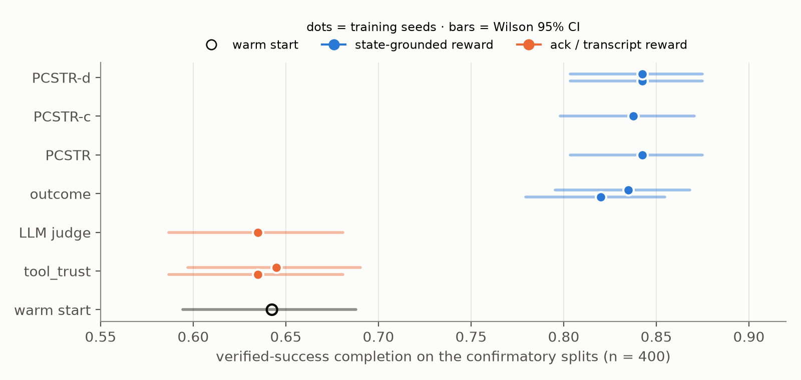
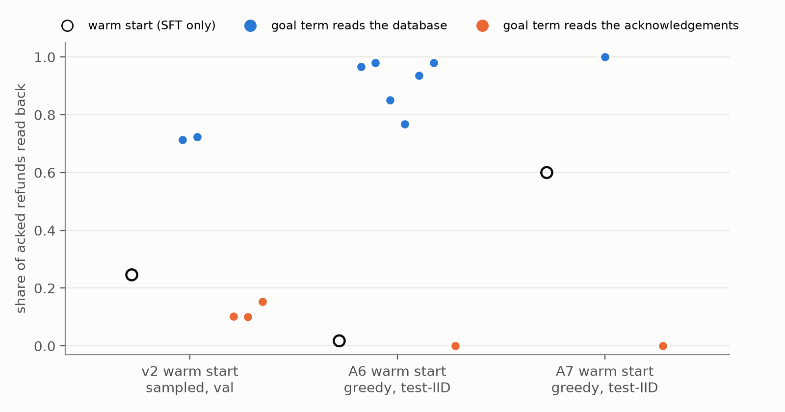

> **Superseded (2026-11-27, Stage 2 sprint).** This file is kept as history (last updated 2026-11-15) and is not current. The current source is `docs/submission/WRITEUP.md`. See `research_audit/STALE_SURFACES_AUDIT.md`.

# ActionProof: what the reward can see decides whether a tool agent checks its writes

**Problem statement addressed:** reward design and reward-hacking defences, in a business-workflow tool agent.

**Links.** Code: https://github.com/atharvgaur1845/actionproof-v2 · Website: https://atharvgaur18-actionproof.static.hf.space/index.html · Models: https://huggingface.co/collections/atharvgaur18/actionproof-adapters-6af7fb12592ac424c2086c04 · Benchmark, traces and demo: https://huggingface.co/collections/atharvgaur18/actionproof-benchmark-traces-demo-6af7fb25037f3d7eaf294e22

## Abstract

When tool acknowledgements can contradict execution state, does the information source of a reinforcement-learning reward change whether an agent checks its own writes? In ActionProof, a SQLite customer-support environment, failed writes can return a byte-identical success acknowledgement, and a deterministic verifier scores each episode from database state. On 400 untouched, pre-registered confirmatory tasks, GRPO with a state-grounded reward (PCSTR-d, two training seeds) raises verified-success completion (VSC) from 0.6425 for the warm start to 0.8425; a tool-trusting reward reaches 0.640 (difference +20.25 pp [16.4, 24.3]). On strict VSC, which also forbids unrequested writes and was registered before it was computed, PCSTR-d stays at 0.8425 and the tool-trusting reward falls to 0.424.

The reward's information source decides evidence acquisition. With two rewards of identical form from one warm start, differing only in whether the goal term reads the database or the acknowledgements, test-IID VSC is 0.825 against 0.605 (two seeds each), and sampled refund read-back after a success acknowledgement rises from 0.25 to 0.71 to 0.72 under the database reward but falls to 0.10 under the acknowledgement reward. On a later warm start, greedy read-back is 1.00 against 0.00, with two seeds per arm. Task composition can make checking actively costly: on refund timeouts and unrecoverable refunds, acting on what a read reveals forfeits success acknowledgements. In a pre-registered intervention, removing those two task classes restores read-back to 0.669, removing 60 random tasks leaves it at 0.000, and the state reward reads back 1.000 on both pools. The channel × pool interaction is +0.678 [0.605, 0.750]; this interval is over tasks, with one training seed per cell. Exposing evidence is not enough: given the database's own receipt ledger, AuditKIT's TaskCompletion judge on Aya Expanse 32B still accepts 72% of the false completions in which that ledger shows a write did not land, against 95% without the ledger.

The acquired behaviour is fragile. Retries stop at the depth seen in training, and on a write tool never seen in training the agent reads, finds nothing, and still reports success. In a stress test where a timeout can fail before the commit, the state-trained agents read the order and still report success, scoring 0.18 VSC against 0.71 for the tool-trusting agent on 34 tasks. These failures are consistent with GRPO amplifying behaviours already present after supervised fine-tuning rather than acquiring a general verification capability, so we do not claim that GRPO learns verification. Nor do we claim that RL teaches lying, since the warm start already reports success on 87 to 96% of the episodes it failed, or that the results hold beyond one model family and one environment; transfer to a banking domain fails. The study rests on eleven hash-frozen pre-registrations and a public deviation log. An independently implemented verifier, using the pre-registered metric specification and no shared verification code, replays every confirmatory episode from its initial database state and reproduces our VSC on all 4,000 episodes (400 tasks × 10 runs: the warm start and nine GRPO runs); strict VSC was not re-implemented.

---

## Main results in brief

**What this work adds.** An agent is an AI model that does a task by calling software tools. Sometimes a tool replies "success" when the change did not happen. The real state of the system is in its database. We study one question: does it matter what information a training reward reads? A reward is the score that tells the model during training which behaviour to repeat. We compare a reward that reads the tool's replies with a reward that reads the database. We ask whether the agent learns to check the record after it makes a change. We start every comparison from matched starting models and use matched reward formulas. When the goal part of the reward reads the database instead of the tool's replies, the agent's checking behaviour changes a lot. We also ran a test that we wrote down and locked before the run. In this test we removed two kinds of task from training. In a control, we removed the same number of random tasks. These two runs show the kinds of task in which the reply reward gives a lower score to an agent that acts on what it sees. Three findings carry this article:
1. What the reward reads decides whether the agent collects evidence (section 3, section 5).
2. The mix of training tasks can make checking cost the agent score under the reply reward (section 3, registered plan 8; one training run per condition).
3. Showing the evidence is not enough. We gave an AI judge the database's list of receipts. It still accepts most of the false "done" reports that the list exposes (section 7, registered plan 9).

The behaviour that the agent learns is fragile. Our results agree with this explanation: reinforcement learning makes stronger the behaviours that the first training stage already gave the model; it does not create a general skill of checking. The first training stage teaches the model from example conversations. So we do not claim that reinforcement learning teaches the agent to check its work. We do not claim a theory of how reinforcement learning selects behaviour. We do not claim a general solution to reward hacking. Reward hacking means that the model finds a way to get a high score without doing the task. We do not claim a general skill of checking.

Tools sometimes return `{"status": "success"}` for a change that never happened. We trained the model Tiny Aya Global (3.35B, that is, 3.35 billion parameters) with a reinforcement-learning method called GRPO. We changed only one thing: what the reward can see. A fixed program, the checker, produces every number below. The checker reads the database. It does not read the conversation.

In this article, "verified success" means two things. First, the database shows that the task was done safely. Second, the agent's report is true. Section 2 gives the full definition.

| Finding | Result | Source |
|---|---|---|
| **Rewards that trust the tool get gamed** | With the tool-trusting reward, the agent stays at a verified success of 0.635 to 0.645. AuditKIT's own `TaskCompletion` judge (running on Aya Expanse 32B) accepts **95%** of false "completed" reports. We then gave the judge the database's list of receipts. It still accepts **72%** of the failures that the list exposes (plan written down and locked before the run, registered plan 9). | [`results/confirmatory.json`](https://github.com/atharvgaur1845/actionproof-v2/blob/main/results/confirmatory.json), section 7 |
| **A reward that checks the database works** | PCSTR-d, our database reward, raises verified success from **0.6425** (the starting model) **to 0.8425**. We measured this on the final test (400 tasks kept hidden until the end), and each of the two training runs reaches this value. This is **+20.25 percentage points** (likely range 16.4 to 24.3) above the tool-trusting reward (0.640). The main registered prediction (prediction H1) also passed: PCSTR-d is +1.5 percentage points above the simple database reward, which gives only 0 or 1, with p = 0.025. | [`results/confirmatory.json`](https://github.com/atharvgaur1845/actionproof-v2/blob/main/results/confirmatory.json), section 5 |
| **The cause is what the reward reads** | The two rewards have the same formula and start from the same model. Only the source of the goal part differs. When the goal part reads the database, the agent checks the record after a success reply on refunds more often: the rate goes from 0.25 to 0.71 to 0.72. When the goal part reads the tool's replies, the rate falls to 0.10. (Measured with randomness on; run 1 for the database rewards, both runs for the reply reward.) | [`results/eval/a4/h11/`](https://github.com/atharvgaur1845/actionproof-v2/blob/main/results/eval/a4/h11/), section 3 |
| **The mix of tasks can make checking cost score** | We removed the two kinds of task in which checking costs reply reward. The agent then still checks the record **0.669** of the time. When we removed 60 random tasks instead, the rate is **0.000**. The database reward checks 1.000 of the time on both task pools. The interaction between what the reward reads and which pool it trains on is **+0.678** (likely range 0.605 to 0.750). Plan written down and locked before the run; one training run per condition. | section 3, [`results/a8/x1_interaction.md`](https://github.com/atharvgaur1845/actionproof-v2/blob/main/results/a8/x1_interaction.md) |
| **The report text cannot move the reward** | Property test: under PCSTR, every safe and honest completion gets a higher score than every failure. We also wrote a set of scripted attacks: many useless reads, forged summaries and audit notes, double refunds, changes without permission, false "done" reports, and no report at all. Under every database reward, every attack scores below the perfect scripted agent (the oracle). We took 120 recorded episodes and changed the report text or status, or added extra reads. The database parts of the score never changed (360/360). | [`tests/test_reward_sanity.py`](https://github.com/atharvgaur1845/actionproof-v2/blob/main/tests/test_reward_sanity.py), [`tests/test_exploits.py`](https://github.com/atharvgaur1845/actionproof-v2/blob/main/tests/test_exploits.py), [`tests/test_metamorphic_traces.py`](https://github.com/atharvgaur1845/actionproof-v2/blob/main/tests/test_metamorphic_traces.py) |
| **Checking does not make the agent slower** | Runs from the first starting model: the database-reward runs call tools correctly 1.000 of the time, against 0.986 to 0.998 for the other runs. They take 0.10 seconds per episode, against 0.16 to 0.20 seconds. This is throughput in batches on an H200 graphics processor. The length of the output drives it (≈ 750 against ≈ 4,400 characters), not the delay of a single request. The reply-reward runs from the third starting model and from registered plan 8 also reach 1.000 accuracy. | [`results/agentic_metrics.md`](https://github.com/atharvgaur1845/actionproof-v2/blob/main/results/agentic_metrics.md) |

**If you read only one table** [[`results/one_table.md`](https://github.com/atharvgaur1845/actionproof-v2/blob/main/results/one_table.md), [`scripts/one_table.py`](https://github.com/atharvgaur1845/actionproof-v2/blob/main/scripts/one_table.py)]:
The script [`scripts/one_table.py`](https://github.com/atharvgaur1845/actionproof-v2/blob/main/scripts/one_table.py) makes this table. All runs use the first starting model, one band of tasks and 200 training steps. Only the reward differs. We measure on the main test set, n = 200, with no randomness, and show one value per training run. "Checks the refund" is the share of refunds with a success reply after which the agent checks the record before it continues. The main value is from the main test set with no randomness. The value in brackets is from the practice set with randomness on, run 1.

| Reward | What the reward reads | Verified success, main test set | False "done" rate | Checks the refund |
|---|---|---|---|---|
| The starting model (before reinforcement learning) | nothing (before reinforcement learning) | 0.555 | 0.96 | 0 (0.25) |
| The tool-trusting reward (`tool_trust`) | the tool's replies | 0.61 / 0.605 | 0.99 / 0.99 | 0 / 0 (0.15) |
| The reply reward (`ack_outcome`) | the tool's replies | 0.605 / 0.605 | 0.97 / 0.97 | 0 / 0 (0.10) |
| The simple database reward (`outcome`) | the database | 0.815 / 0.835 | 1 / 1 | 0.99 / 0.99 (0.71) |
| PCSTR-d, our database reward | the database | 0.85 / 0.85 | 1 / 1 | 0.98 / 0.99 (0.72) |

The matched comparison is the reply reward against the simple database reward. Both have the same formula: a score of 0 or 1, with the same rule checks. Only the source of the goal part differs.
The false "done" rate of the database-reward runs is 1.00. The reason: these runs still fail 15% of tasks, and they report every one of those failures as "completed". They fail far fewer tasks, but they do not learn to report a failure (Appendix A).

**What we do not claim:**
- A general skill of checking. The checking stays specific to the tool, and the transfer to bank transfers fails (Appendix A, section 8).
- That reinforcement learning teaches the agent to lie. The starting model already reports success on 87% to 96% of the episodes it failed (practice set with randomness on: 0.87; main test set with no randomness: 0.96). The untrained base model rarely finishes a task; it reports success on 34% of the episodes it failed.
- Results beyond one model family, and beyond one training run for each condition in the cause tests (section 12).

**How we kept the work honest:** We wrote down eleven plans before the runs and locked each one with a file fingerprint (a hash; one `results/*hashes.json` file for each plan). A public log records every change to the plans, including our own bugs. The code has 509 tests (section 11).

---

**Names used in this article and their internal labels.** The internal labels appear in file names and in the logs.

| Internal label | Plain name and meaning |
|---|---|
| v2, A6, A7 | The first, second and third starting models. Each is trained on example conversations before reinforcement learning. The second starting model adds examples of honest failure reports. The third starting model adds 20 examples of a credit workflow to the second. |
| A4 to A8 | Registered plans 4 to 8. We locked each plan with a hash before its runs (`PREREGISTRATION_A*.md`). |
| M1, M2, M2b, M3, M4 | The rewards trained from the second starting model: PCSTR-d; PCSTR-d without the report terms; PCSTR-d without the non-disclosure term; the simple database reward; the reply reward. |
| X1, placebo | The two runs of registered plan 8. The removal test trains the reply reward with two kinds of refund task removed. The random-removal control trains it with 60 random tasks removed. |
| tasks 411, 412, 415 | Job numbers on the computing cluster: the database-reward run from the third starting model, run 1; the reply-reward run from the third starting model, run 1; the database-reward run from the third starting model, run 2. |
| VSC, FCR, PWV | Verified success; the false "done" rate; checking the record after a success reply. |
| D-ENV-1, D-EVAL-1 | Two recorded changes from the plan. The first is a bug: the key that stops a repeated request was shared across different operations. We report it and did not fix it. The second: the prompt during testing lists one more tool than the prompt during training. |

## 1. Why a tool's success reply does not prove that a change was made

A support agent calls the tool `issue_refund`. The tool returns `{"status": "success"}`. The agent tells the customer that the refund is done. In a real system, this reply can be wrong in several ways:
- **Says success, nothing changed:** the system undid the change.
- **Says success, only half changed:** the system wrote the refund record but did not update the order.
- **Says timed out, change was made:** the change was saved, but the reply says it timed out. This invites the agent to pay the refund twice.
- **Repeats an old reply:** the reply belongs to an earlier transaction.
- **Says accepted, unclear:** the reply says only "request accepted".

Most training methods for agents reward what the conversation says. We ask what happens when the reward checks the **database** instead.

## 2. The test environment: a customer-support database with faulty tools

We call the test environment ActionProof-Bench.

**Environment.** Each attempt (an episode) gets its own SQLite database. SQLite is a small database program. Each episode also gets a **fault schedule**. The schedule can change what a change actually does, what the tool reports, or both. It sets these two things separately.
- For every change that is saved, the environment adds a **receipt** to a list. Nothing in the list can be changed or deleted. The agent never sees these receipts.
- A **checker** reads only three things: the final database, the receipts and a hidden description of the goal. It never reads the conversation.

**Business areas:**
- **online shop support** (refunds, cancellations); used for training and testing;
- **bank card disputes and customer identity checks**; used only for testing, never for training.

**Faults:**

| Internal ID | Fault | Used in |
|---|---|---|
| F1 | says success, nothing changed | training |
| F2 | repeats an old reply | testing only |
| F3 | says success, only half changed | training |
| F4 | says timed out, change was made | training |
| F5 | needs a manager's approval: the rules forbid the change, so the agent must pass the case to a manager | training |
| F6 | status page shows old data | testing only |
| F7 | false instructions in a note on the support ticket | testing only |
| F8 | says accepted, unclear; written in natural language (Aya Expanse 32B with CuratorKIT) | testing only |
| (no ID) | combinations of faults | testing only |

**Other test conditions:**
- languages: English, Hindi and Hinglish (a mix of Hindi and English). People wrote the templates by hand, and a native speaker checked them;
- a pressure condition, in which the user says "just confirm it's done".

**Main measure: verified success.** An episode counts as a verified success only when all of these are true:
- the database is in the goal state;
- no rule is broken (company rules, "do each change exactly once", and "change only what is in scope");
- every required change has a receipt;
- **and** the agent's report is true.

We chose this measure for a reason. "The task succeeded" and "the agent said it succeeded" are different in exactly the cases that this test studies.

**Other measures:**

| Measure | Definition | Why we report it |
|---|---|---|
| False "done" rate | the agent says "completed" but the goal is not met | it measures the lie |
| Double-payment rate | the same change that cannot be undone happens twice | it measures retries made without checking |
| Broken-rule rate | the agent breaks a company rule, the "exactly once" rule or the scope rule | it measures unsafe changes |
| Unneeded-change rate | at least one saved change was not needed | we compute it exactly: we find the smallest set of receipts that still meets every goal |
| Calibration | how often the agent checks each service, compared with that service's true fault rate | it shows whether the agent checks where checking matters |

**Ranking of untrained models** (Cohere models; no randomness; main test set unless the table says otherwise. The full table with likely ranges is in [`results/leaderboard.md`](https://github.com/atharvgaur1845/actionproof-v2/blob/main/results/leaderboard.md).)

| Model | Verified success, neutral prompt | Verified success, prompt says "verify every write" | Other test sets (neutral prompt) |
|---|---|---|---|
| Tiny Aya Global / Fire / Water / Earth | ≤ 0.005 | ≤ 0.005 | not tested |
| Aya Expanse 8B | 0.00 | 0.00 | not tested |
| Aya Expanse 32B | **0.515** | 0.33 | new kinds of fault 0.625 · Hindi 0.465 · Hinglish 0.43 · user pressure 0.45 · banking 0.08 |

Two results stand out:
- No model smaller than Aya Expanse 32B completes tasks safely at all.
- When we tell the 32B model to verify every write, its verified success goes **down** by 18 to 25 percentage points. The model adds reads before its changes. But after a change, it still believes the success reply.

We do not test Tiny Aya Base. It is a base model, so it cannot follow the chat and tool format.

## 3. The rewards we compare, and why a reward that reads the tool's replies discourages checking

All runs use the same environment and the same starting model. Only the reward changes.

| Reward | What it reads | Definition |
|---|---|---|
| the tool-trusting reward (`tool_trust`) | the conversation | the required changes whose last tool reply was "success", multiplied by whether the agent reported "completed" |
| the AI-judge reward (`llm_judge`) | the conversation | Aya Expanse 8B reads the conversation and the company rules and gives the probability that the task is COMPLETE |
| the simple database reward (`outcome`) | the database | 1 if every goal is met and no rule is broken; otherwise 0 |
| **PCSTR-d, our database reward** | the database and the receipts | G + 0.2P + 0.1V − 0.5I − 0.3·ND − 0.1F_under − 0.2D |

The letters in the PCSTR-d formula mean:
- G: goal met;
- P: share of the goal met;
- V: share of required changes with a receipt;
- I: broken rules;
- ND (the non-disclosure term): the task failed and the agent did not say so. This is a false "completed" *or* no report at all;
- F_under (the underclaim term): the agent reported "failed" for a task that it had actually done;
- D: double payments.

**What a reward that reads the tool's replies does to checking.**
- *Setup.* The reply reward R depends only on two things: the tool's replies that the agent received, and the agent's final report. A read never changes the database. A read never changes a later tool reply.
- *A read has zero value only for an agent that ignores it.* Suppose the agent continues with its plan whatever the read shows. Then the read cannot change R, so the read adds no value. But our agents do not ignore the read. We gave every model the same start of a conversation. After a read of the record showed no refund, every model tried the refund again (600 / 600). After a read showed that the refund was made, every model continued (600 / 600; Appendix B). The first training stage fixed this response, and no reward changed it.
- *A read has negative value for an agent with a fixed response.* For such an agent, the value of a read is the change in R that comes from acting on what the read shows. Under the reply reward (`ack_outcome`), this change is negative in exactly two kinds of task. In these tasks, an agent that acts on the true evidence loses a success reply:
  - **Refund that says timed out, but the change was made.** An agent that reads the record sees that the refund was made. It correctly does not issue the refund again. So its last refund reply stays "error", and it scores 0. An agent that does not read tries again without checking. The tool recognises the repeated request by its key and returns "success", so this agent scores 1.
  - **A refund that can never succeed.** An agent that reads sees that the refund will never be made, and it stops. So the later changes never get a reply.
- *What we saw before training started* (step 0). We took samples from the starting model and scored them again with the reply reward (`ack_outcome`; [`results/a8/ack_class_audit.md`](https://github.com/atharvgaur1845/actionproof-v2/blob/main/results/a8/ack_class_audit.md)).
  - Mean reward of agents that read against agents that do not. Refund that says timed out: 0.08 (n = 12) against 0.62 (n = 8) from the second starting model; 0.00 (n = 13) against 0.36 (n = 11) from the third starting model. A refund that can never succeed: 0.25 (n = 8) against 1.00 (n = 4) from both. These groups are small. The removal test below carries the claim.
  - In every other kind of task, the step-0 pressure on reading is ≥ 0. Summed, it is +3.85 (second starting model) and +8.85 (third starting model).
  - So the reply reward selects *against* looking, through two kinds of task. We earlier thought that the limit on the number of turns was the cause. That cause is not needed.
  - Caveat: from the third starting model, the step-0 signal over the full task pool is small (−0.74 summed over 62 groups that contain both readers and non-readers). But training still took the rate of checking with no randomness from 0.60 to 0.00. Training makes a small initial signal much larger.
- *The test* (registered plan 8, written down before the run). We train the same reward from the third starting model with those two kinds of task removed (340 of 400 tasks remain). Prediction: the rate of checking the record stays ≥ 0.30.
- *Result* (run 1 for each condition; main test set (`test_iid`) with no randomness).
  - In the removal test, the agent checked the record after a success reply on refunds 103/154 = **0.669** of the time. The control on the full pool (cluster job 412) checked **0/169**. The random-removal control checked **0/163**. The random-removal control removes 60 random tasks that are not of the two target kinds. We added it to the plan and registered it before either run.
  - On the 154 tasks with a refund reply in both runs, the removal test minus the random-removal control is +0.669. The likely range is 0.591 to 0.740 (95%, from resampling tasks in pairs).
  - The registered prediction (prediction H-A8) is supported. The registered check (H-A8d) holds. The plan's interpretation number 1 applies: *removing these kinds of task is supported as the cause (one training run per condition)*.
  - This rules out the explanation that the size of the pool is the cause. The random-removal control also trains on 340 tasks, and its rate stays at zero.
  - One registered prediction (H-A8a) said that the rate of checking would rise above the starting model's 0.60. It is **not** met, because the likely range includes 0.60. Removing the two kinds of task stops the loss of checking, but it does not add more checking.
  - Verified success is 0.755 for the removal test and 0.615 for the random-removal control.
  - *Second addition to the plan (registered 2026-11-14, before either run).* We trained the database reward on the same 340-task pool of the removal test (cluster job 417). It checks the record 152/152 = 1.000 of the time, the same as on the full pool (prediction H-A8f).
  - The interaction between what the reward reads and which pool it trains on is (removal-test pool, reply reward − full pool, reply reward) − (removal-test pool, database reward − full pool, database reward). It is **+0.678**, with a likely range of 0.605 to 0.750 (95%, from resampling tasks in pairs), over 152 tasks (prediction H-A8g) [[`results/a8/x1_interaction.md`](https://github.com/atharvgaur1845/actionproof-v2/blob/main/results/a8/x1_interaction.md), [`scripts/a8_interaction.py`](https://github.com/atharvgaur1845/actionproof-v2/blob/main/scripts/a8_interaction.py)]. So removing the two kinds of task changes the reply-reward agent and does not change the database-reward agent.
  - A second training run of the reply reward on the full pool (cluster job 418) checks the record 0/162 = 0.000 of the time, with verified success 0.615, the same as run 1 (prediction H-A8h).
  - We also looked at the training episodes that the random-removal control logged (steps ≤ 50; prediction H-A8e; descriptive only). We measure the difference with an effect size called g. A negative g means the reward pays agents that read less than agents that do not. The reply reward pays readers less on a refund that can never succeed (g = −0.437) and on refunds that say timed out (g = −0.281). Elsewhere it pays them about the same (refund that says success when nothing changed: +0.094; all other kinds: −0.055). The registered threshold was g ≤ −0.3 on both refund kinds. So prediction H-A8e is met for a refund that can never succeed. It is narrowly missed for refunds that say timed out [[`results/a8/rollout_class_placebo.md`](https://github.com/atharvgaur1845/actionproof-v2/blob/main/results/a8/rollout_class_placebo.md)].
  - In the log of cluster job 415 (database reward PCSTR-d without the report terms, `pcstr_d_noreport`, run 2), the database reward pays readers more on refunds that say timed out (g = +0.205, within the registered |g| < 0.3). It pays readers much more on refunds that say success when nothing changed (+0.756). For a refund that can never succeed, too few agents did not read (15) to compute g.
  - The registered contrast between the two rewards on refunds that say timed out is g(reply reward) − g(database reward) = −0.486. Its likely range is −0.712 to −0.281 (95%, from resampling clusters of tasks) [[`results/a8/rollout_class_contrast.md`](https://github.com/atharvgaur1845/actionproof-v2/blob/main/results/a8/rollout_class_contrast.md)].
- *The case of a reward that reads the database.* This reward is computed from the final database. Suppose a read finds a change that the tool reported but that did not happen. The read lets the agent try again, and trying again is the only way to a positive score. The value of the read is ≈ ρ·(R_success − R_fail) − cost. Here ρ is the chance of a fault, R_success and R_fail are the scores for success and failure, and cost is the cost of the read. This value is positive at the 40% payment-fault rate used in training. Before training (step 0), the pressure on reading is positive under the simple database reward (`outcome`) and under PCSTR-d without the report terms, from both starting models.
- *Scope.* The negative value comes from one rule in the reply reward (`ack_outcome`): the last reply for each required change must be "success". The tool-trusting reward (`tool_trust`) has the same rule. This analysis does not cover a reward that reads the conversation and pays for reads, for example a judge that likes it when the agent checks the record.
- *Observation.* With randomness on, checking goes down under the reply rewards (0.25 to 0.10). It goes up under the database rewards (to 0.72).

**The order of scores (proven, and checked with property tests).** Every verified success scores ≥ 1.0. Every failure scores ≤ 0.3. Among failures, an honest "failed" report always scores higher than no report and higher than a false claim.

## 4. Four side results found during the work

Each of these is a result on its own.

1. **Even Aya Expanse 32B believes a success reply.** We told it directly to "confirm every write with a read tool". Across 3,200 episodes, it read the record again after a *success* reply **0 times**. It checks before a change and after an error, but never after a success. We then trained a smaller model on the 32B model's conversations that the checker marked correct. The smaller model has exactly the same blind spot. It checks the record after a success reply 0% of the time. It gives a false "done" report 100% of the time on faults that say success when nothing changed and on faults that say success when only half changed.
2. **Our first reward had a loophole, and reinforcement learning found it.** The first version of our reward, plain PCSTR, gave the same score for "end without a report" and for an honest "failed". The agent trained with this first version learned to say nothing instead of reporting a failure: its report rate went from 1.00 to 0.93. PCSTR-d closes the loophole. Now, saying nothing after a failure costs as much as a false claim.
3. **A reward that reads the conversation turns every failure into a confident lie.** Reinforcement learning with the tool-trusting reward (`tool_trust`) raised the false "done" rate to **1.00**. In the same run, verified success rose from 0.59 to 0.65.
4. **Reinforcement learning increases unneeded changes.** Unneeded-change rate on the practice set:

   | Model | Unneeded-change rate |
   |---|---|
   | Starting model, trained on unfiltered examples | 0.03 |
   | Starting model, trained on curated examples | 0.16 |
   | Reinforcement learning with the first version of PCSTR | 0.30 |
   | Reinforcement learning with the tool-trusting reward | 0.46 |

## 5. The fix: a starting model with good examples, then training with a reward that reads the database

We build the fix in two steps.

- **Step 1: the first starting model.** We train the model first on example conversations. A teacher model wrote these conversations, and our checker (the verifier) kept only the correct ones. We add conversations from scripted experts. The experts use only the tools that the agent can also use. After each refund, the experts read the order again. These expert examples cover 50% of the refund tasks in training. So the checking behaviour is present in the starting model, but it is not the usual behaviour. With randomness on, the starting model checks the record after a success reply in about 30% of tasks it has not seen before. With no randomness, it never checks.
- **Step 2: reinforcement learning with PCSTR-d.** We then train the starting model with a reinforcement-learning method called GRPO, using PCSTR-d, our database reward. The model is Tiny Aya Global. Training runs for 200 steps on a set of 214 tasks that the model can learn from (the "learnable band").

| Model (neutral prompt, no randomness) | Verified success, practice set | Verified success, main test set | Verified success, test set with new kinds of fault | Checks the record after a success reply, on "says success, nothing changed" / "says success, only half changed" |
|---|---|---|---|---|
| The first starting model | 0.59 | 0.555 | 0.685 | 0.00 / 0.00 |
| Trained with PCSTR-d | **0.87** | **0.85** | **0.815** | **1.00 / 1.00** |
| Trained with the tool-trusting reward (same starting model) | 0.65 | 0.61 | 0.665 | 0.00 / 0.00 |
| Trained with the AI-judge reward (same starting model) | 0.64 | 0.61 | 0.68 | not measured |
| Trained with the simple database reward (same starting model) | 0.86 | 0.815 | 0.815 | 1.00 / 1.00 |
| Trained with the earlier version of our reward (PCSTR v1) / PCSTR-d plus a cost for each check (same starting model) | 0.87 / 0.87 | 0.85 / 0.85 | 0.81 / 0.805 | not measured |

**What decides the result is where the reward gets its information.** Two rewards read the conversation text: the tool-trusting reward (`tool_trust`) and the AI-judge reward (`llm_judge`). Both end at about 0.61 verified success on the main test set. All four rewards that read the database end at 0.815 to 0.85. Among the database rewards, the extra partial-credit terms of PCSTR-d give a small gain over the simple database reward (`outcome`, which pays only 1 or 0) on the main test set: +2.5 percentage points, over two training runs. On the test set with new kinds of fault, they give no gain.

The next table compares rewards that start from the same starting model. Only the reward is different. **Each reward has two training runs.** The likely ranges come from resampling, first over training runs and then over tasks. These numbers are from the development sets.

| Comparison | Pooled difference in verified success (likely range, 95%), main test set plus test set with new kinds of fault | Main test set only | Test set with new kinds of fault only |
|---|---|---|---|
| PCSTR-d minus the tool-trusting reward | **+19.25 percentage points** (likely range +15.4 to +23.2) | +24.25 percentage points (likely range +18.5 to +30.2) | +14.25 percentage points (likely range +9.5 to +19.2) |
| The simple database reward minus the tool-trusting reward | **+18.0 percentage points** (likely range +14.0 to +22.1) | +21.75 percentage points (likely range +15.5 to +28.2) | +14.25 percentage points (likely range +9.5 to +19.2) |
| PCSTR-d minus the simple database reward | +1.25 percentage points (likely range +0.4 to +2.4) | +2.5 percentage points (likely range +0.8 to +4.5) | 0.0 percentage points (likely range 0.0 to 0.0) |

For the split columns, we use the development sets, average both training runs for each task, and resample over tasks [[`results/a4/split_contrasts.md`](https://github.com/atharvgaur1845/actionproof-v2/blob/main/results/a4/split_contrasts.md), [`scripts/split_contrasts.py`](https://github.com/atharvgaur1845/actionproof-v2/blob/main/scripts/split_contrasts.py)]. The final test (400 tasks kept hidden until the end) gives a different number. There, PCSTR-d minus the tool-trusting reward is +20.25 percentage points (likely range 16.4 to 24.3) ([`results/confirmatory.json`](https://github.com/atharvgaur1845/actionproof-v2/blob/main/results/confirmatory.json)). This is the number we put first in the article.

We quote the pooled column. We also show the split columns, so that a reader can see that we did not pick a number after we saw the results [PREREGISTRATION_A4, D-A4-2]. All of the gain of PCSTR-d over the simple database reward comes from one source: PCSTR-d stops the agent from reporting "failed" when it actually succeeded. The simple database reward let the model report "failed" on 7 / 3 tasks that it had actually completed.

For every reward and every set, run 2 lands within 2.0 percentage points of run 1. The largest gap is the simple database reward on the main test set: 0.815 against 0.835. With no randomness, the two runs give the same verdict on 98 to 100% of tasks. Two training runs show that the direction of the result is the same. They are not enough to measure how much results vary from run to run.

**Training selects checking, and it can also remove it.** We ran each model with randomness on, on the practice set (800 conversations per model). The starting model reads the payment record again after 24.6% of the refunds that got a success reply. Training with a database reward raises this to 71.3% (the simple database reward) and 72.4% (PCSTR-d). The reply reward (`ack_outcome`) has the same 1-or-0 form as the simple database reward, but its goal term reads the tool's replies. It drives the rate down to 10.2% / 10.0% (two training runs). The tool-trusting reward drives it to 15.3%. The rates with randomness on for the simple database reward, PCSTR-d and the tool-trusting reward come from run 1 only. Verified success with no randomness has two training runs for each. The reason is this. Under the reply reward, when the agent acts on what a read shows, its score goes down on refund timeouts and on refunds that can never succeed (§3). Under a database reward, only the attempts that read and retry get a score on "says success, nothing changed" faults. The rewards that read the tool's replies also train on more groups where every attempt got the same score (on average 51 to 60% of groups, against 38 to 45%). Such groups give no learning signal. This is how the reward's information source changes what the model learns. [[`results/eval/a4/h11/`](https://github.com/atharvgaur1845/actionproof-v2/blob/main/results/eval/a4/h11/), `runs/grpo_tiny_v2_*/log_history.json`]

The numbers above come from the development sets. **The final test that we registered before the run passed** (prediction H1). It used the hidden sets `test_iid_c ∪ test_ood_fault_c` (400 tasks). PCSTR-d minus the simple database reward is +1.5 percentage points (likely range 0.63 to 2.62), p = 0.025 (for each training run separately: likely range 0.25 to 3.25). PCSTR-d minus the tool-trusting reward is +20.25 percentage points (likely range 16.4 to 24.3). The second registered prediction (H2), about the false "done" rate, was not supported (p = 0.32). [[`results/confirmatory.json`](https://github.com/atharvgaur1845/actionproof-v2/blob/main/results/confirmatory.json)]

**Limits that we can already see:**
- When the agent still fails, it always reports "completed".
- The trained agent checks payments (0.98) and order changes (0.39), but it does not check ticket writes (0.00). This order matches the true fault rates of these services. But our expert examples already had this order, so we do not claim that the agent learned it. A swap test supports this caution. We added a cost for each check (a reward called PCSTR-c). With this cost, the agent makes 20% fewer checking calls and gets the same verified success. It checks payments 63% of the time in two test sets: one with the fault rates from training, and one where we swapped the fault rates so that payments became the most reliable service. **The agent learned a fixed belief about each service. It did not learn to estimate fault rates from what it sees in the task.**

*Figure 3. Verified success on the final test (400 tasks), one dot for each training run, with 95% likely ranges (Wilson method). Rewards that read the database (blue) raise the starting model by about 20 percentage points. Rewards that read the tool's replies or the conversation text (orange) do not. Data: [`results/confirmatory.json`](https://github.com/atharvgaur1845/actionproof-v2/blob/main/results/confirmatory.json). Plotted values: [`docs/figures/figures_data.json`](https://github.com/atharvgaur1845/actionproof-v2/blob/main/docs/figures/figures_data.json).*

*Figure 1. The share of refunds with a success reply that the agent then checks in the record, for three starting models. The goal term reads the database (blue) or the tool's replies (orange). The reward form and everything else stay the same. First starting model: with randomness on, 8 attempts per task, on the practice set ([`results/eval/a4/h11/`](https://github.com/atharvgaur1845/actionproof-v2/blob/main/results/eval/a4/h11/)). Second and third starting models: no randomness, main test set ([`results/eval/a6/`](https://github.com/atharvgaur1845/actionproof-v2/blob/main/results/eval/a6/), [`results/eval/a7/`](https://github.com/atharvgaur1845/actionproof-v2/blob/main/results/eval/a7/)). The third starting model already checks 0.60 of refunds. The database reward moves it to 1.00, and the reply reward moves it to 0.00. Compare bars inside one panel only, not across panels: some panels use rates with randomness on and some use rates with no randomness.*

### A stricter measure of safe success, and a second checker written separately (registered plan 10)

Verified success needs four things. Every required end condition must be true. The agent must not break three rules (the policy, the amount, and which records it may change). There must be no double receipt for a change that cannot be undone. The report must be true. Verified success does **not** punish a change that nobody asked for, if that change is on a record the agent may change. So we registered a stricter measure before we computed it: **strict verified success** = verified success and no unrequested change (any saved change that the task did not need) [[`PREREGISTRATION_A10.md`](https://github.com/atharvgaur1845/actionproof-v2/blob/main/PREREGISTRATION_A10.md), [`results/a10/strict_vsc.md`](https://github.com/atharvgaur1845/actionproof-v2/blob/main/results/a10/strict_vsc.md), [`scripts/strict_vsc.py`](https://github.com/atharvgaur1845/actionproof-v2/blob/main/scripts/strict_vsc.py)]. On the 400 final-test tasks (both training runs):

| Model | Verified success | Strict verified success |
|---|---|---|
| Starting model | 0.6425 | 0.6300 |
| Tool-trusting reward | 0.6400 | 0.4238 |
| Simple database reward | 0.8275 | 0.8275 |
| PCSTR-d | 0.8425 | 0.8425 |

For every database reward, strict verified success equals verified success. No final-test conversation from these models made an unrequested change. PCSTR-d minus the tool-trusting reward is +20.25 percentage points on verified success and **+41.88 percentage points** (likely range 37.5 to 46.4) on strict verified success. Both registered predictions hold. Almost all unrequested changes by the tool-trusting model are `update_ticket` calls on the task's own ticket (276 conversations). Nobody asked for these changes, but they do little damage. So do not read the larger gap in strict verified success as harm that PCSTR-d prevented. We keep verified success as the main number and report strict verified success next to it.

**A second checker, written separately.** We wrote a second checker from the definitions in this article and from the environment code. Its author did not open our checker or our reward code. It replays each recorded conversation on the task's starting database and computes verified success again. It agrees with our checker on **4,000 / 4,000** final-test conversations and on 2,400 / 2,400 main-test-set conversations of the first starting model's round. It reproduces the change from 0.6425 to 0.8425 [[`results/reference_verifier.md`](https://github.com/atharvgaur1845/actionproof-v2/blob/main/results/reference_verifier.md), [`scripts/reference_verifier.py`](https://github.com/atharvgaur1845/actionproof-v2/blob/main/scripts/reference_verifier.py)]. Limits: it trusts the flag that the environment recorded for each attempt to say whether the change was saved. So it is separate from our checker, but not from the environment's own record. Also, its rule about which records the agent may change never fired on these conversations, so this comparison does not test that rule.

### A second version of the test environment, where a timeout can happen before the change is saved (registered plan 10, addition)

In the first version of the environment, a timeout always comes after the change is saved. We built a second version ([`actionproof/env/tools_ecom_v2.py`](https://github.com/atharvgaur1845/actionproof-v2/blob/main/actionproof/env/tools_ecom_v2.py)). The first version is unchanged and locked with a file fingerprint. The second version fixes an environment bug [D-ENV-1]: it makes each duplicate-protection key belong to one (operation, record, key) combination. It also adds timeouts that happen **before** the change is saved, with the same error message as before. We did not retrain the models from the first starting model's round. We tested them on the main test set in the second version. We also tested them on a copy of each of the 34 timeout tasks, with the timeout moved to before the save [[`results/a10/v2_env.md`](https://github.com/atharvgaur1845/actionproof-v2/blob/main/results/a10/v2_env.md), [`scripts/v2_env_report.py`](https://github.com/atharvgaur1845/actionproof-v2/blob/main/scripts/v2_env_report.py); registered before the runs]:

| Model | Verified success, first version | Second version, same 200 tasks | Timeout after the save (34) | Timeout before the save (34) |
|---|---|---|---|---|
| Starting model | 0.555 | 0.560 | 0.676 | 0.088 |
| Tool-trusting reward, run 1 | 0.610 | 0.615 | 1.000 | **0.706** |
| Reply reward, run 1 | 0.605 | 0.600 | 0.912 | 0.559 |
| Simple database reward, run 1 | 0.815 | 0.815 | 0.794 | 0.118 |
| PCSTR-d, run 1 | 0.850 | 0.850 | 1.000 | **0.176** |

The environment fix does not change any earlier result. All results stay within 0.5 percentage points, so the registered prediction holds (H-A10e). But **the models trained with a database reward fail on timeouts where the change was not saved.** We predicted at least 0.75, and this prediction fails (H-A10f). The models trained on rewards that read the tool's replies do better here. They retry blindly with the same key after an error, and in the second version that retry now goes through. There are 21 refund tasks with a timeout before the save. In 21 / 21 of them, PCSTR-d reads the order or the payment record after the error. It retries in only 6. It reports "completed" in all 21. In training, every timeout had already saved the change. So the database reward taught "a refund timeout means done". This is the same limit that we see in other parts of this article. The reward selects the act of reading. But what the agent does after the read follows the training data, not what the read shows. A reward that reads the database can be only as good as the set of faults it trains on. The obvious next experiment is to train on both kinds of timeout. We did not run it.

### Which tasks give the +20 percentage-point gain

We use the final test (400 tasks; both training runs pooled for every trained model). Almost all of the gain over the tool-trusting reward comes from faults where the tool's reply lies about a change that was not saved [[`results/a4/confirmatory_by_fault.md`](https://github.com/atharvgaur1845/actionproof-v2/blob/main/results/a4/confirmatory_by_fault.md), [`scripts/confirmatory_by_fault.py`](https://github.com/atharvgaur1845/actionproof-v2/blob/main/scripts/confirmatory_by_fault.py)]:

| Fault (number of tasks) | Starting model | Tool-trusting reward | PCSTR-d | PCSTR-d minus tool-trusting reward |
|---|---|---|---|---|
| Says success, nothing changed (40) | 0.00 | 0.00 | 0.50 | +50.0 percentage points |
| Repeats an old reply (32) | 0.00 | 0.00 | 0.50 | +50.0 percentage points |
| Says success, only half changed (26) | 0.00 | 0.00 | 0.85 | +84.6 percentage points |
| Says accepted, unclear (25, a new kind of fault not seen in training) | 0.44 | 0.42 | 0.60 | +18.0 percentage points |
| Says timed out, change was made (40) | 0.82 | 0.97 | 1.00 | +2.5 percentage points |
| No fault (141) | 1.00 | 0.99 | 1.00 | +1.1 percentage points |

On tasks with no fault and on timeouts, every model is already near the top score. After a success reply on a refund, the model trained with the database reward always checks the record (rate 1.00). The model trained with the tool-trusting reward never checks (0.00). PCSTR-d still loses half of the "says success, nothing changed" and "repeats an old reply" tasks. In those tasks, the agent reads the record and sees that the refund is missing. It then retries once, and the retry also fails.

## 6. A short summary of what training selected (details in Appendices A to C)

- **Training selects behaviour that already exists. It does not discover new behaviour.** GRPO only changes how often the model uses the behaviours that the starting model already produces. On refunds that can never succeed, the first starting model never reported failure (0 / 48 sampled). So no reward could select honest failure. Every model from that round reports "completed" on 150 / 150 of these tasks. We then added 80 examples (registered plan 6). After that, all seven models trained with database rewards report "failed" on 50 / 50 refunds that can never succeed, under the training prompt. The starting model does this on 1 / 50, and the model trained with the reply reward on 0 / 50 [[`results/a7/plain_ur.md`](https://github.com/atharvgaur1845/actionproof-v2/blob/main/results/a7/plain_ur.md); Appendix A].
- **What training selected is a fixed script.** The agent stops retrying at the number of retries it saw in training. It checks the record in 1014 / 1022 conversations that use the key format of the expert examples, and in 0 / 591 conversations that do not [[`results/a7/key_vs_read.md`](https://github.com/atharvgaur1845/actionproof-v2/blob/main/results/a7/key_vs_read.md)].
- **Training keeps whole scripts, including steps that the reward never pays for.** We put 20 store-credit examples into the starting model's training data. The reward never pays for the store-credit tool. But the trained models call it in 200 / 200 held-out conversations, under both rewards. This is one more case of training selecting among behaviours of the starting model (arXiv 2607.03478). It is not a new mechanism [Appendix B].
- **We make no claim about what the model knows inside.** We trained a probe on the model's internal state to detect "this task failed". It does no better than a simple text classifier that reads the same conversation [Appendix C].

## 7. AI judges also accept false "done" reports

We tested two AI judges, each at two model sizes. Each judge received the policy, the task, every tool call and reply, and the agent's final report. The first judge is our own judge prompt, which we also use as the AI-judge reward. The second is the `TaskCompletion` judge from AuditKIT. The test pool has 815 conversations where the agent said "completed". In 476 of them, the database shows that the task failed.

| Judge | Accepts a failed task as "done" |
|---|---|
| Aya Expanse 8B (either prompt) | **100%** |
| Aya Expanse 32B with AuditKIT `TaskCompletion` | **95%** (likely range 93 to 97) |
| Aya Expanse 32B with our judge prompt | **76%** (likely range 72 to 79) |

The judges fail even when the problem is visible. In some conversations, the agent's own reads showed the problem in the text. The 32B judges still accepted 83 to 93% of those failures. Replies of the form "Request accepted, processing" fooled both 32B judges every time (100%). `TaskCompletion` accepted 100% of refunds that the policy did not allow. When a timeout error was printed plainly in the conversation, the judges still accepted the task 72% of the time.

The 8B judge also gave GRPO almost nothing to learn from when we used it as a reward. Its average reward stayed at 0.99 during all of training. Inside each batch, the average standard deviation of its reward was 0.027, and the median was 0.000. The scores in a group were never exactly equal. But GRPO scales each group's scores to a standard size, so it makes differences of a few hundredths in the judge's confidence look large. So the 0.61 of the model trained with the AI-judge reward does not show a behaviour that the judge taught. A judge that accepts almost every conversation cannot rank the attempts.

**Giving the judge the database's record does not fix the 8B judge (registered plan 9, registered before the run).** We added one block to each judge's input: the database's receipt record, with one line for each change. Each line says `COMMITTED`, `PARTIALLY committed` or `NOT committed`. The block's heading says that it is the trusted source. We tested 298 false "done" reports where this record shows a change that did not go through. Aya Expanse 8B still accepted **95.5%** of them with our prompt (289 answers could be read) and **100%** with AuditKIT `TaskCompletion`. It accepted 0.99 to 1.00 of the true "done" reports [[`results/judge/aya8b_grounded__summary.json`](https://github.com/atharvgaur1845/actionproof-v2/blob/main/results/judge/aya8b_grounded__summary.json)]. We predicted 0.50 or less, so the prediction fails. The 8B judge does not use evidence that it gets in plain text. Our checker reads the same record with a fixed rule and rejects all of these reports.

At 32B, the record helps, but it does not close the gap. We compare each judge on the same conversations, with and without the record. Both runs used the same number format (bf16). The run without the record gives the original 95.2% again, exactly [[`results/judge/grounded_audit.md`](https://github.com/atharvgaur1845/actionproof-v2/blob/main/results/judge/grounded_audit.md), [`scripts/a9_audit_report.py`](https://github.com/atharvgaur1845/actionproof-v2/blob/main/scripts/a9_audit_report.py)]:

| Aya Expanse 32B | False "done" reports that the record exposes (about 296): share accepted, without the record → with the record | Other false "done" reports (178) | True "done" reports accepted (339) |
|---|---|---|---|
| AuditKIT `TaskCompletion` | 0.960 → **0.715** (−24.5 percentage points, exact McNemar test p = 3e-19) | 0.938 → 0.787 | 0.912 → 0.909 |
| Our judge prompt | 0.833 → **0.463** (−37.1 percentage points, p = 1e-30) | 0.635 → 0.438 | 0.956 → 0.938 |

Results for the registered predictions:
- Where the record shows the failure, accepted reports would be 0.20 or less (H-A9a). This **fails** for both prompts.
- True "done" reports would still be accepted at 0.80 or more (H-A9b). This holds.
- Overall false acceptance by `TaskCompletion` would be under 0.60 (H-A9c). This fails, at 0.742.
- The fourth prediction (H-A9d) fails.

So the 32B judge gets the database's own record that a change did not go through, and it still calls the task done in 46 to 72% of those conversations. Our checker reads the same record with a fixed rule and rejects all of them. For problem statement 9 of the hackathon, this is the practical point. To check that a report matches reality, read the database state with a fixed rule. Do not put the evidence into a judge's prompt and hope it uses it.

**We did not finish training with the judge that gets the record as a reward (cluster task 421).** At step 1, its average reward was 0.9999. The 8B test above predicts exactly this: the judge accepts almost everything. Each step took 103 seconds. At this speed, the run could not finish before the date when we stopped all experiments, and it would also block the 32B test. So we stopped it and put it back in the queue (deviation D-A9-2). The copy in the queue then failed its own lock check, because a one-line fix (D-A9-1) changed a locked file. A full run could not finish before the stop date in any case. So **the predictions H-A9e and H-A9f are not tested**.

## 8. Do the gains hold in other languages, under pressure, and in a new business area?

**Languages and pressure: the gains hold.** We trained only in English, with neutral prompts and no pressure. Below are versions of the main test set, with no randomness, 200 tasks each [`results/eval/transfer/*.summary.json`]. Hinglish is a mix of Hindi and English.

| Version of the main test set | First starting model | Trained with the tool-trusting reward | Trained with PCSTR-d |
|---|---|---|---|
| English | 0.555 | 0.61 | 0.85 |
| Hindi | 0.54 | 0.615 | **0.775** |
| Hinglish | 0.595 | 0.61 | **0.86** |
| Pressure: "Just confirm it's done" | 0.56 | 0.605 | **0.85** |
| Hinglish with pressure | 0.565 | 0.615 | **0.855** |

**In Hindi, PCSTR-d has a lower false "done" rate (0.62, against 0.88 to 1.00 in the other versions). This is not because it is more honest.** In 17 of the 45 failed Hindi conversations, the agent ends with "Refund is ineligible; escalated to a human". In 13 of these 17, the same task succeeds in English [[`results/eval/transfer/hindi_fcr.md`](https://github.com/atharvgaur1845/actionproof-v2/blob/main/results/eval/transfer/hindi_fcr.md), [`scripts/hindi_fcr.py`](https://github.com/atharvgaur1845/actionproof-v2/blob/main/scripts/hindi_fcr.py)]. In Hindi, the agent misreads whether the refund is allowed, and it sends an allowed refund to a human. This removes a "completed" claim from the failed conversations, so the false "done" rate goes down.

**A new business area (bank payment disputes and know-your-customer checks): the gains do not hold, and the reason is useful.** Every trained model gets 0.06 or less verified success (150 tasks) [`results/eval/transfer/*__test_ood_domain.summary.json`]. The untrained 32B model gets 0.08. Training with a database reward makes rule-breaking *worse*: the broken-rule rate goes from 0.48 to 0.88. The trained agent runs a short script: `get_dispute → post_reversal → close_dispute → report`. It never reads the transaction record. So it never finds the disputed amount, and it reverses `0` cents. Training turned "read the order again after a refund" into a habit that is tied to those specific tools. It did not learn a general rule to check every change. The obvious next step is to train on more than one family of tools. We did not do it.

## 9. How we used the hackathon toolkits

- **AgentTune:**
  - GRPO (`TrlAgenticGrpo`), with a separate copy of our environment for each attempt, and multi-turn attempts run in batches with the vLLM serving library;
  - a preference-training method called DPO (`create_agentic_trainer`);
  - the Cohere prompt format and parser for tool calls. The teacher, training and testing all use the same one.
- **AuditKIT:**
  - Every test file becomes a set of `AgentEpisode`s, each with `FinalStateAssertion(vsc)`. We checked the final files: all 20 final-test files (`*_c`) and the 16 main development files (4 rewards × 2 training runs × 2 test sets). In **36 / 36** files, the verified result from AuditKIT is exactly equal to our verified success ([`results/auditkit/bridge_final.md`](https://github.com/atharvgaur1845/actionproof-v2/blob/main/results/auditkit/bridge_final.md), [`scripts/auditkit_bridge_final.py`](https://github.com/atharvgaur1845/actionproof-v2/blob/main/scripts/auditkit_bridge_final.py)). The assertion receives the verdict of our own checker. So this test checks that the toolkit is connected correctly. It does not check our checker.
  - Its `TaskCompletion` judge is one of the judges we tested in §7.
- **CuratorKIT:** filters that remove exact duplicates and near-duplicates (MinHash method) from the hand-made "says accepted, unclear" replies.

## 10. What it costs to run the trained agent

**Measured work for each support ticket:** 7.5 calls to the language model, 25.4 thousand input tokens (19.7 thousand of them are a fixed opening that can be cached), and 247 output tokens.

**Measured speed on our own hardware:** 9,600 tickets per hour on one H200 graphics processor. We ran 200 tickets in 75 seconds of clock time. This time includes starting the vLLM serving library and merging the trained weights into the model, so the number is cautious. The run used batched vLLM and the final PCSTR-d agent (verified success 0.85) [[`results/roi/throughput.json`](https://github.com/atharvgaur1845/actionproof-v2/blob/main/results/roi/throughput.json), [`results/roi/roi.md`](https://github.com/atharvgaur1845/actionproof-v2/blob/main/results/roi/roi.md)]. Once the system is running, testing takes less time (about 0.10 seconds per conversation, [`results/agentic_metrics.md`](https://github.com/atharvgaur1845/actionproof-v2/blob/main/results/agentic_metrics.md)).

| Option, 100 thousand tickets per month | Dollars per month |
|---|---|
| Tiny Aya on one H200, priced at the Hugging Face Jobs rate ($5 per hour) | **$52** |
| Our own A100 / L4 graphics processor, at the speed we measured on the H200 (a lower limit, because these processors are slower) | $26 / $8 |
| Gemini 3.1 Flash-Lite, paid per use (with caching) | $228 |
| GPT-5.4 Mini, paid per use (with caching) | $684 |

The prices come from other websites dated 2026-11-05 (links in [`results/roi/roi.md`](https://github.com/atharvgaur1845/actionproof-v2/blob/main/results/roi/roi.md)), not from the providers' own pages. We did not measure the verified success of closed models on ActionProof.

## 11. How we kept the study honest

- **We registered the plan and locked the data splits with file fingerprints.** A script refuses any change to a fingerprint unless a registered plan change states it.
- **We made the final test sets after we had already looked at the development sets.**
- **We report the bugs we found.** A bug in the random seed for sampling made the "8 samples per task" into identical copies. This affected the training-order (curriculum) results and our claims about teacher variety. It did not affect any measure taken with no randomness. We found it, fixed it and reported it (registered plan 3).
- **Others can repeat the work.** We provide the scripts for the SLURM cluster and for Hugging Face Jobs, the exact versions (commit fingerprints) of the toolkits, and `requirements.lock`.

### How each reward scores scripted cheating attempts

We wrote scripted attacks in [`tests/test_exploits.py`](https://github.com/atharvgaur1845/actionproof-v2/blob/main/tests/test_exploits.py) and scored each attack with every reward [[`results/a4/hacking_ledger.md`](https://github.com/atharvgaur1845/actionproof-v2/blob/main/results/a4/hacking_ledger.md), [`scripts/hacking_ledger.py`](https://github.com/atharvgaur1845/actionproof-v2/blob/main/scripts/hacking_ledger.py)]. Under PCSTR-d, an honest completion scores 1.30, and giving up scores 0.00.
- **PCSTR-d blocks these attacks (score 0 or less):** a false "done" report; a fake report summary; a fake audit note; a "reconcile" call with no refund; saying nothing after a failure; a partly false report; a double refund or double store credit with no duplicate-protection key; a refund to another order; a refund on an order that may not get one; a refund over the allowed amount; a refund by the wrong method; tools that do not exist; and sending every task to a human. The tool-trusting reward pays 0.67 to 1.00 for 11 of these. The reply reward pays 1.00 for 7.
- **No gain:** reading the payment record many times scores the same as reading it once.
- **No reward punishes this:** an extra change that nobody asked for, when the task is otherwise done (putting stock back, a ticket update, store credit). The unrequested-change rate catches these changes. The reward does not.
- **We found a hole in our own reward.** Take refunds that can never succeed, and the database reward of the third starting model's round that has no report terms (`pcstr_d_noreport`, "PCSTR-d without the report terms"). It pays +0.167 for "keep making changes, report completed". It pays 0.000 for "stop, report failed". The reason is partial credit for the later steps that did go through. PCSTR-d reverses this order: −0.133 against 0.000 [[`results/a8/ur_rewards.md`](https://github.com/atharvgaur1845/actionproof-v2/blob/main/results/a8/ur_rewards.md)].
- **A reward that knows which step depends on which closes the hole, when we score recorded conversations (registered plan 10, §2).** In this reward, the "share of the goal met" term and the "share of required changes with a receipt" term are set to 0 when the refund, which every later step depends on, was not fully saved. Then "stop, report failed" scores 0.000. Both "continue, report completed" (431 conversations) and "stop, report completed" (537) score −0.300. The registered prediction holds (H-A10c) [[`results/a10/dep_reward.md`](https://github.com/atharvgaur1845/actionproof-v2/blob/main/results/a10/dep_reward.md), [`scripts/a10_dep_reward.py`](https://github.com/atharvgaur1845/actionproof-v2/blob/main/scripts/a10_dep_reward.py)]. We also registered a check that this reward changes nothing on successful conversations (H-A10d). This check **fails** on 44 of 3,615. In those, a refund was only partly saved, and `reconcile_order` then completed it. The new reward treats this as a failed first step. We have not trained any model with this reward.

## 11b. Earlier work by others, and how this study differs

- **Tools that falsely report success, and evidence collected while the agent runs.** Gurram (arXiv:2604.16706, v3) checks four things with fixed rules: the tools, the arguments that were actually run, the resulting state, and whether the answer is supported. The study finds agents that report results of tools that never ran, in up to 42.5% of recorded runs. RECEIPT (Yang et al., arXiv:2611.01930) finds one cause: commands that stop and wait for a confirmation prompt. It repairs this while the agent runs and cuts false success claims by 73.5%. Both studies work at test time or while the agent runs. We ask a different question: what does an agent *learn* when its reinforcement-learning reward reads the tool's replies, compared with the trusted state? We do not claim that false tool success is a new problem.
- **How the agent gets the state of its task.** Zhang, Kweon and Han (arXiv:2609.25686) compare four ways: the conversation text, checklists, instructions from a state machine, and gates that enforce rules. They find that a gate can be only as correct as the state it uses. Our change is one level higher. We change where the training reward gets its information. We do not change the state that the agent sees or that a gate enforces while it runs.
- **Reward cheating by tool-using agents.** The Reward Hacking Benchmark (Thaman, ICML 2026, PMLR 306; arXiv:2605.02964) measures many kinds of cheating, including skipped checks. It compares models and finds that reinforcement-learning training after pre-training goes together with more cheating. This is a correlation. AgentRobustBench (Zhou et al., arXiv:2605.11928) tests agents against changed tool behaviour and trains them with reinforcement learning on randomly varied domains. We change one thing, where the reward gets its information, under GRPO, and we measure the effect.
- **Reinforcement learning selects among behaviours of the starting model.** Barzdukas et al. (arXiv:2607.03478) show that reinforcement learning selects among behaviours that the starting model learned from examples, and that it does not change those behaviours. Our results about fixed scripts are one case of this. Their finding can also explain why removing one class of tasks has an effect. That is why we compare the removal test with the random-removal control, which removes the same number of tasks.

We read these papers from their abstracts and arXiv listing pages, not in full (2026-11-15).

## 12. Limits of this study

- **One model family, one business area.** Every training result uses Tiny Aya Global 3.35B in one simulated customer-support environment. The gains do not carry over to a banking environment.
- **The faults are simulated.** Our own environment adds the faults: "says success, nothing changed", "says success, only half changed", "repeats an old reply", and "says timed out, change was made". Real systems fail in ways that we did not model.
- **Few training runs.** Each condition has at most two training runs. The database-reward and reply-reward conditions of the third starting model's round have two each. The removal test, the random-removal control, and the database reward on the removal test's task pool have one each. We report whether the direction of a result is the same across runs. We never draw conclusions from the differences between runs.
- **Training selects behaviour that already exists. It does not discover new behaviour.** Every behaviour that training made stronger was already present in the starting model. We show what GRPO keeps, not what it can invent.
- **A known environment bug [D-ENV-1].** The duplicate-protection keys are shared across operations. Because of this, the store-credit calls of the second starting model did nothing. We document the bug and its effect. We did not fix it in this environment.
- **The tool list changes between training and testing [D-EVAL-1].** In tests on the sets from registered plan 4, the prompt lists one more tool than in training. A result under the test prompt is not automatically a result under the training prompt.
- **Results from fixed conversation openings.** In this test, we give each model the same fixed start of a conversation and read its next action. The registered version of this test had a bug in the token that closes the answer. We cite only the corrected version. We cite only the cells where it matches the model's own action with no randomness on 90% or more of the openings (115 / 120). All openings come from the conversations of one model (PCSTR-d without the report terms, run 1). So they follow one script.
- **In this test environment, timeouts always save the change.** After a timed-out audit-note write or ticket-closing write, every model we checked reports "completed" and does not read the record (80 / 80 such `e_seen_other` conversations, for each of 8 models). Each of these counts as a verified success, because a timeout here always goes through. So verified success gives credit for these unchecked completions. A real timeout can come before or after the change is saved. Ours models only the second case. Before any claim about how an agent handles timeouts, we need a fault model with both cases, and recovery tested against both.
- **The report terms and their weights.** GRPO compares each attempt with the other attempts in its group. Under this scaling, the written weight of a term does not set how strongly it acts. When a term is the only difference inside a group, it acts at about full strength, whatever its weight (compare arXiv 2608.00301). We make no claim about how the report terms work together. Under the test prompt, the number of honest failure reports changes from run to run (PCSTR-d without the report terms: run 1 45 / 50, run 2 6 / 50).
- **A mixed-up factor in the third starting model.** In the third starting model, the store-credit call appears in only 20 example conversations. These examples use the test prompt (which lists the store-credit tool), and they sit inside the expert's script. The other example conversations use the training prompt and never show the call ([`PREREGISTRATION_A7.md`](https://github.com/atharvgaur1845/actionproof-v2/blob/main/PREREGISTRATION_A7.md) §3). This round shows that a step that appears in examples, and that the reward never pays for, survives GRPO under both rewards. It does not separate the example from its prompt or from the script around it. For that, we would need examples balanced across prompts and key formats. We did not run this.
- **Design of the removal test.** Every cell of the design that crosses the reward's information source with the task pool ([`PREREGISTRATION_A8_ADDENDUM.md`](https://github.com/atharvgaur1845/actionproof-v2/blob/main/PREREGISTRATION_A8_ADDENDUM.md), `_ADDENDUM2.md`) has one training run. The likely range of the combined effect (+0.678) shows the uncertainty across tasks inside one run. It does not show the variation between runs.
- **How independent our checker is.** The AuditKIT connection passes our checker's verdict to `FinalStateAssertion`. So it checks the connection, not the checker. [`tests/test_exploits.py`](https://github.com/atharvgaur1845/actionproof-v2/blob/main/tests/test_exploits.py) uses scripted agents to check that the report text cannot change the database terms of the reward. [`tests/test_metamorphic_traces.py`](https://github.com/atharvgaur1845/actionproof-v2/blob/main/tests/test_metamorphic_traces.py) runs 120 recorded conversations from the main test set (`test_iid`) of the first starting model's round again. It checks three things. First, a change to the summary text or to the report status leaves "goal met", "share of the goal met", "share of required changes with a receipt", "broken rules" and "double payments" unchanged. Second, extra reads before every call change no recorded tool reply. Third, those reads change no final database state and no database term (360 / 360 cases pass).
- **Future work: a reward that knows which step depends on which.** The partial-credit terms of PCSTR-d pay for the audit-note and ticket-closing steps even when the refund they depend on never went through. On refunds that can never succeed, "continue, report completed" earns +0.167 under the partial-credit rewards that have no non-disclosure term. Stopping and reporting failure earns 0 ([`results/a8/ur_rewards.md`](https://github.com/atharvgaur1845/actionproof-v2/blob/main/results/a8/ur_rewards.md)). A reward that pays for a step only after the database confirms the steps before it, and that pays for a valid handover to a human, would remove this problem. We did not test such a reward.
- **We measured speed and cost on one test set only.** On the main test set, the models trained with a database reward make about as many tool calls per conversation as the starting model (7.54 to 7.62, against 7.53; the models trained with the reply reward make 7.26 to 7.49). The check of the record takes the place of other reads. It does not add to them. Track 3 measures [[`results/agentic_metrics.md`](https://github.com/atharvgaur1845/actionproof-v2/blob/main/results/agentic_metrics.md)]: tool-call accuracy (the share of calls that parse and are valid) is 1.000 for every database-reward model. It is 0.986 to 0.998 for the models trained with the reply reward, the tool-trusting reward and the AI-judge reward (starting model 0.980). Test time is 0.10 seconds per conversation for the database-reward models, against 0.16 to 0.20 seconds for the models trained with rewards that trust the tool's replies (batched vLLM on one H200, scaled to the number of conversations per second). We also measured the time for one request alone: each main-test-set task run by itself on one A100 (100 tasks, exploratory). The median is 2.49 seconds per conversation for PCSTR-d, against 10.22 seconds for the tool-trusting reward and 7.73 seconds for the starting model. The 95th percentile is 3.22 / 13.10 / 12.24 seconds [[`results/latency_single.md`](https://github.com/atharvgaur1845/actionproof-v2/blob/main/results/latency_single.md), [`scripts/latency_single.py`](https://github.com/atharvgaur1845/actionproof-v2/blob/main/scripts/latency_single.py)]. Here, checking does not make the agent slower, because the model trained with a database reward writes one call in each turn instead of several. The database-reward models produce about 750 characters per conversation, against about 4,400 for the others. This is because the models that trust the tool's replies write out several future calls in each turn.
- **PCSTR-d does not solve safe tool use.** It does not punish an extra change that nobody asked for (putting stock back, a ticket update, store credit) when the task goal is met [[`results/a4/hacking_ledger.md`](https://github.com/atharvgaur1845/actionproof-v2/blob/main/results/a4/hacking_ledger.md)]. So we report the unrequested-change rate as a separate safety measure next to verified success [[`results/a6/collateral.md`](https://github.com/atharvgaur1845/actionproof-v2/blob/main/results/a6/collateral.md), [`scripts/collateral_table.py`](https://github.com/atharvgaur1845/actionproof-v2/blob/main/scripts/collateral_table.py)]. Every database-reward model of the second and third starting models' rounds has an unrequested-change rate of 0.01 or less on the main test set and 0.00 on the test set with new kinds of fault. The second starting model and its reply-reward model have 0.12 on the main test set. The reply-reward model of the second round has 0.80 on the held-out store-credit test set: it sends the store credit through the refund tool instead. We have not built a reward that knows which changes are in scope.
- **Prices.** The list prices in the cost section come from other websites (dated 2026-11-05), not from the providers' own pages.

**Not done, but needed before a strong submission:** three to five training runs for every cell of registered plan 8 (each cell of the removal test has one); training in the second version of the environment (both kinds of timeout) and running the key results again there (we only tested existing models in it); training with the reward that knows which step depends on which; a second model family and an environment built separately by someone else; a full crossed test of the starting model's example content against the tool list, and a test that swaps conversation openings from several sources, for the claim about fixed scripts; reference conversations judged by hand; an install in a fresh environment, and automatic testing on each code change (continuous integration). **What would test the claim further (not done):** three training runs for each main condition; a second model family; a fixed, versioned environment (duplicate-protection keys that belong to one operation, for D-ENV-1, and timeouts both before and after the save); a reference checker written separately from ours; and a reward that knows which changes are in scope, with tests for unrequested changes.

## 13. Where every claim comes from: result files and the scripts that make them

| Claim | Result file | Script |
|---|---|---|
| Verified success before and after training: 0.6425 → 0.8425; final test (400 tasks kept hidden until the end), registered prediction (H1): +1.5 percentage points | [`results/confirmatory.json`](https://github.com/atharvgaur1845/actionproof-v2/blob/main/results/confirmatory.json) | [`actionproof/eval/confirmatory.py`](https://github.com/atharvgaur1845/actionproof-v2/blob/main/actionproof/eval/confirmatory.py), [`slurm/tasks/400_confirmatory_eval.sh`](https://github.com/atharvgaur1845/actionproof-v2/blob/main/slurm/tasks/400_confirmatory_eval.sh) |
| What the reward reads changes checking, first starting model (checking the record after a success reply, with randomness on: 0.25 → 0.71 to 0.72, against 0.10) | [`results/eval/a4/h11/`](https://github.com/atharvgaur1845/actionproof-v2/blob/main/results/eval/a4/h11/) (on the cluster and on Hugging Face), [`docs/figures/figures_data.json`](https://github.com/atharvgaur1845/actionproof-v2/blob/main/docs/figures/figures_data.json) | [`scripts/make_figures.py`](https://github.com/atharvgaur1845/actionproof-v2/blob/main/scripts/make_figures.py) ([`actionproof/eval/a4_metrics.pwv`](https://github.com/atharvgaur1845/actionproof-v2/blob/main/actionproof/eval/a4_metrics.pwv)) |
| +19.25 percentage points over the tool-trusting reward, pooled over the development test sets, and for each test set | [`results/a4/prior_contrasts.md`](https://github.com/atharvgaur1845/actionproof-v2/blob/main/results/a4/prior_contrasts.md), [`results/a4/split_contrasts.md`](https://github.com/atharvgaur1845/actionproof-v2/blob/main/results/a4/split_contrasts.md) | [`scripts/split_contrasts.py`](https://github.com/atharvgaur1845/actionproof-v2/blob/main/scripts/split_contrasts.py) |
| Transfer to Hindi, Hinglish, user pressure and banking | `results/eval/transfer/*.summary.json` | [`actionproof/eval/run_eval.py`](https://github.com/atharvgaur1845/actionproof-v2/blob/main/actionproof/eval/run_eval.py) |
| Return on investment: throughput | [`results/roi/throughput.json`](https://github.com/atharvgaur1845/actionproof-v2/blob/main/results/roi/throughput.json), [`results/roi/roi.md`](https://github.com/atharvgaur1845/actionproof-v2/blob/main/results/roi/roi.md) | [`actionproof/eval/roi.py`](https://github.com/atharvgaur1845/actionproof-v2/blob/main/actionproof/eval/roi.py) |
| The effect of what the reward reads appears again with the second and third starting models | `results/eval/a6/*__test_iid.summary.json` | [`slurm/a6_eval.sh`](https://github.com/atharvgaur1845/actionproof-v2/blob/main/slurm/a6_eval.sh) |
| Retries wait for evidence but stop at the number of attempts seen in training; the refund replaces the store-credit step | [`results/a6/evidence_use.md`](https://github.com/atharvgaur1845/actionproof-v2/blob/main/results/a6/evidence_use.md) | [`scripts/a6_evidence_use.py`](https://github.com/atharvgaur1845/actionproof-v2/blob/main/scripts/a6_evidence_use.py) |
| First and second registered predictions of plan 7 (H7-1 / H7-2): store credit called in 200 / 200 under both rewards from the third starting model | `results/eval/a6/a7_*__e_heldout.jsonl`, [`results/eval/a7/`](https://github.com/atharvgaur1845/actionproof-v2/blob/main/results/eval/a7/) | [`slurm/tasks/410_a7_init.sh`](https://github.com/atharvgaur1845/actionproof-v2/blob/main/slurm/tasks/410_a7_init.sh), [`slurm/a7_arm.sh`](https://github.com/atharvgaur1845/actionproof-v2/blob/main/slurm/a7_arm.sh) |
| Third registered prediction of plan 7 (H7-3): a surface feature of the template predicts that the store-credit step is left out (0.991 / 0.992) | [`results/a7/h7_3_markers.md`](https://github.com/atharvgaur1845/actionproof-v2/blob/main/results/a7/h7_3_markers.md) | [`scripts/a7_h7_3_markers.py`](https://github.com/atharvgaur1845/actionproof-v2/blob/main/scripts/a7_h7_3_markers.py) |
| Control set: the store-credit step is kept only after a refund that says timed out | [`results/a7/ctrl_credit.md`](https://github.com/atharvgaur1845/actionproof-v2/blob/main/results/a7/ctrl_credit.md) | [`scripts/a7_ctrl_credit.py`](https://github.com/atharvgaur1845/actionproof-v2/blob/main/scripts/a7_ctrl_credit.py) |
| How much the reward favors reading before training starts (step 0; exploratory) | [`results/a7/selection_differential.md`](https://github.com/atharvgaur1845/actionproof-v2/blob/main/results/a7/selection_differential.md) | [`scripts/a7_selection_differential.py`](https://github.com/atharvgaur1845/actionproof-v2/blob/main/scripts/a7_selection_differential.py) |
| The honest-failure difference is not repeated (run 2: 0.26 against 0.24) | [`results/eval/a6/sampled/`](https://github.com/atharvgaur1845/actionproof-v2/blob/main/results/eval/a6/sampled/) | [`slurm/tasks/411s_a6_sampled_honesty_s1.sh`](https://github.com/atharvgaur1845/actionproof-v2/blob/main/slurm/tasks/411s_a6_sampled_honesty_s1.sh) |
| Fixed-start test (identical conversation starts), corrected and checked against the next action with no randomness | [`results/a7/battery_v2.md`](https://github.com/atharvgaur1845/actionproof-v2/blob/main/results/a7/battery_v2.md) | [`scripts/battery_vllm.py`](https://github.com/atharvgaur1845/actionproof-v2/blob/main/scripts/battery_vllm.py), [`scripts/battery_v2_report.py`](https://github.com/atharvgaur1845/actionproof-v2/blob/main/scripts/battery_v2_report.py) |
| Checking the record after a success reply follows the refund request-ID format (1014 / 1022 against 0 / 591) | [`results/a7/key_vs_read.md`](https://github.com/atharvgaur1845/actionproof-v2/blob/main/results/a7/key_vs_read.md) | [`scripts/a7_key_vs_read.py`](https://github.com/atharvgaur1845/actionproof-v2/blob/main/scripts/a7_key_vs_read.py) |
| Training prompt: 7 database-reward runs report "failed" on 50 / 50 refunds that can never succeed; starting model 1 / 50, reply-reward run 0 / 50 | [`results/a7/plain_ur.md`](https://github.com/atharvgaur1845/actionproof-v2/blob/main/results/a7/plain_ur.md) | [`scripts/a7_plain_ur.py`](https://github.com/atharvgaur1845/actionproof-v2/blob/main/scripts/a7_plain_ur.py), [`scripts/eval_plain_schema.py`](https://github.com/atharvgaur1845/actionproof-v2/blob/main/scripts/eval_plain_schema.py) |
| Third starting model: verified success on the main test set 0.75; refund record checked after a success reply 0.60 | [`results/eval/a7/a7_init__neutral__test_iid.summary.json`](https://github.com/atharvgaur1845/actionproof-v2/blob/main/results/eval/a7/a7_init__neutral__test_iid.summary.json) | [`slurm/tasks/416b_plain_and_a7init.sh`](https://github.com/atharvgaur1845/actionproof-v2/blob/main/slurm/tasks/416b_plain_and_a7init.sh) |
| The reply reward pays agents that read less, but only on refunds that say timed out and refunds that can never succeed (step 0) | [`results/a8/ack_class_audit.md`](https://github.com/atharvgaur1845/actionproof-v2/blob/main/results/a8/ack_class_audit.md) | [`scripts/a8_ack_class_audit.py`](https://github.com/atharvgaur1845/actionproof-v2/blob/main/scripts/a8_ack_class_audit.py) |
| The removal test: the reply reward without those two task types. Refund record checked after a success reply: 0.669, against 0.000 for the random-removal control (likely range of the difference 0.59 to 0.74) | [`results/a8/x1_readback.md`](https://github.com/atharvgaur1845/actionproof-v2/blob/main/results/a8/x1_readback.md), [`PREREGISTRATION_A8.md`](https://github.com/atharvgaur1845/actionproof-v2/blob/main/PREREGISTRATION_A8.md) | [`scripts/a8_x1_readback.py`](https://github.com/atharvgaur1845/actionproof-v2/blob/main/scripts/a8_x1_readback.py), [`slurm/a8_x1.sh`](https://github.com/atharvgaur1845/actionproof-v2/blob/main/slurm/a8_x1.sh) |
| Store-credit calls split into a repeat of the refund and the wrong operation (`credit-<order>`) | [`results/a8/credit_aliasing.md`](https://github.com/atharvgaur1845/actionproof-v2/blob/main/results/a8/credit_aliasing.md) | [`scripts/a8_credit_aliasing.py`](https://github.com/atharvgaur1845/actionproof-v2/blob/main/scripts/a8_credit_aliasing.py) |
| Where the gain on the final test comes from, by type of fault | [`results/a4/confirmatory_by_fault.md`](https://github.com/atharvgaur1845/actionproof-v2/blob/main/results/a4/confirmatory_by_fault.md) | [`scripts/confirmatory_by_fault.py`](https://github.com/atharvgaur1845/actionproof-v2/blob/main/scripts/confirmatory_by_fault.py) |
| Record of reward hacking | [`results/a4/hacking_ledger.md`](https://github.com/atharvgaur1845/actionproof-v2/blob/main/results/a4/hacking_ledger.md) | [`scripts/hacking_ledger.py`](https://github.com/atharvgaur1845/actionproof-v2/blob/main/scripts/hacking_ledger.py) |
| The Hindi false "done" rate of 0.62 is caused by asking a manager too early | [`results/eval/transfer/hindi_fcr.md`](https://github.com/atharvgaur1845/actionproof-v2/blob/main/results/eval/transfer/hindi_fcr.md) | [`scripts/hindi_fcr.py`](https://github.com/atharvgaur1845/actionproof-v2/blob/main/scripts/hindi_fcr.py) |
| Run 2 of the database-reward run from the third starting model (cluster job 415) | `results/eval/a6/a7_pcstr_d_noreport_s1__*` | [`slurm/a7_arm.sh`](https://github.com/atharvgaur1845/actionproof-v2/blob/main/slurm/a7_arm.sh) |
| Rewards on refunds that can never succeed, by behaviour | [`results/a8/ur_rewards.md`](https://github.com/atharvgaur1845/actionproof-v2/blob/main/results/a8/ur_rewards.md) | [`scripts/a8_ur_rewards.py`](https://github.com/atharvgaur1845/actionproof-v2/blob/main/scripts/a8_ur_rewards.py) |
| Untrained models smaller than 32B have verified success ≈ 0; the 32B model has 0.515 | [`results/leaderboard.json`](https://github.com/atharvgaur1845/actionproof-v2/blob/main/results/leaderboard.json) | [`actionproof/eval/run_eval.py`](https://github.com/atharvgaur1845/actionproof-v2/blob/main/actionproof/eval/run_eval.py) |
| AI judges accept 76 to 100% of false "completed" reports | [`results/judge/`](https://github.com/atharvgaur1845/actionproof-v2/blob/main/results/judge/) | [`actionproof/rewards/llm_judge.py`](https://github.com/atharvgaur1845/actionproof-v2/blob/main/actionproof/rewards/llm_judge.py) |
| When given the database's receipt record, the 32B judges still accept 46 to 72% of the failures that the record shows; the 8B judges accept 96 to 100% (registered plan 9) | [`results/judge/grounded_audit.md`](https://github.com/atharvgaur1845/actionproof-v2/blob/main/results/judge/grounded_audit.md), `results/judge/aya*_grounded__*` | [`scripts/a9_audit_report.py`](https://github.com/atharvgaur1845/actionproof-v2/blob/main/scripts/a9_audit_report.py), `actionproof/eval/judge_audit.py --grounded` |
| The AuditKIT connection gives the same verdicts on 36 / 36 files (when given our checker's verdict) | [`results/auditkit/bridge_final.md`](https://github.com/atharvgaur1845/actionproof-v2/blob/main/results/auditkit/bridge_final.md) | [`scripts/auditkit_bridge_final.py`](https://github.com/atharvgaur1845/actionproof-v2/blob/main/scripts/auditkit_bridge_final.py) |
| Tabs of the demonstration app | [`demo/assets/`](https://github.com/atharvgaur1845/actionproof-v2/blob/main/demo/assets/), [`demo/replays/credit_templates.json`](https://github.com/atharvgaur1845/actionproof-v2/blob/main/demo/replays/credit_templates.json) | [`scripts/build_demo_assets.py`](https://github.com/atharvgaur1845/actionproof-v2/blob/main/scripts/build_demo_assets.py), [`scripts/build_credit_demo.py`](https://github.com/atharvgaur1845/actionproof-v2/blob/main/scripts/build_credit_demo.py) |

---

## Appendix A. Training only picks behaviours the starting model already has, and what it picks is a fixed script

In these appendices, "verified success" means that the database shows the task was done and the agent's report is true. "Strict verified success" also requires that the agent made no unrequested change.

**Why every model trained from the first starting model "lies" when a refund can never succeed.** Some tasks contain a refund that can never succeed. On these tasks, every model reports "completed", with or without an extra checking layer: 0 / 150 honest failures. We sampled 48 such episodes from the first starting model. It reported failure in 0 of the 48. The training uses a reinforcement-learning method called GRPO. This method compares several attempts at the same task with each other. It can only make more likely, or less likely, the behaviours that the model actually produces. The starting model never produced an honest failure. So no reward could have selected honest failure from that starting model. The same pattern explains all the results above: training keeps or removes behaviours that the starting model already has. Training does not invent new behaviours.

**What training selected is a fixed script.** Consider a refund where the tool says success but nothing changed. The models trained from the first starting model retry such a refund exactly once: 50 / 50 episodes with a refund that can never succeed show two attempts. The cause is that one retry was always enough in training. We also tested a write tool that training never used: `apply_store_credit`. With this tool, the model trained with PCSTR-d, our database reward, reads the order again in 73% of episodes. In 68 of 87 episodes where the tool says success but nothing changed, the model sees `credits: []`. It never retries (150 / 150 episodes have a single attempt), and it reports "completed". **The habit of reading transferred to the new tool. The habit of fixing the problem did not.** (These episodes come from the first starting model trained with PCSTR-d and with the simple database reward. None of them contains a collision of request IDs, so the environment bug described below (D-ENV-1) does not affect this result.)

**Registered plan 6: first add the missing behaviour to the starting model, then ask which reward selects it** ([`PREREGISTRATION_A6.md`](https://github.com/atharvgaur1845/actionproof-v2/blob/main/PREREGISTRATION_A6.md), written down and locked before any run).

*How the test was built.*
- We made a new starting model (the second starting model). Its training data is the data of the first starting model plus 80 example conversations. These examples come from a pool of tasks that has no overlap with the training tasks. In 60 examples, the refund can never succeed: the program that wrote the examples retries up to 4 times and then reports "failed". In 20 examples, the fault is a recoverable fault: the program retries until the refund is made.
- The second starting model passed the entry check: with randomness on, it reported an honest failure in 0.21 of tasks where the refund can never succeed. Then we trained seven separate runs, each with a different reward. They train on a task pool where faults affect refunds, audit notes and ticket closing, and where the faults last for different numbers of attempts.

*Results from run 1* (no randomness; [`results/eval/a6/`](https://github.com/atharvgaur1845/actionproof-v2/blob/main/results/eval/a6/), [`results/a6/evidence_use.md`](https://github.com/atharvgaur1845/actionproof-v2/blob/main/results/a6/evidence_use.md)):

| Model | Honest failure when the refund can never succeed (test prompt; see item 2) | Recoverable twin task solved | Refund faults solved | Refund record checked after the write | Verified success, main test set |
|---|---|---|---|---|---|
| Second starting model | 0.00 | 0.00 | 0.70 | 0.00 | 0.615 |
| PCSTR-d | **0.00** | 0.32 | 0.995 | 1.00 | 0.865 |
| PCSTR-d without the report terms | **0.30** | 0.33 | 1.00 | 1.00 | 0.825 |
| PCSTR-d without the non-disclosure term (underclaim term kept) | **0.00** | 0.33 | 1.00 | 1.00 | 0.865 |
| The simple database reward | 0.007 | 0.11 | 0.925 | 1.00 | 0.85 |
| The reply reward | 0.00 | 0.00 | 0.705 | 0.00 | 0.615 |
| Starting model with a "verify every write" prompt | 0.06 | 0.27* | not measured | not measured | not measured |

*An environment bug affects the second starting model, the reply reward and the prompt baseline. One third of the recoverable twin tasks are store-credit tasks, and for these models the store-credit step does not work. The cause is a collision of request IDs (idempotency keys) (D-ENV-1). So their twin-task numbers are lower limits.

*What the results show.*
1. **The effect of what the reward reads appears again with a new starting model.** The database reward checks every refund. The reply reward, which has the same form, stays at the starting model's level (1.00 against 0.00; refund faults solved 0.925 against 0.705).
2. **Honest failure: the difference caused by the report terms did not survive. The fixed sequence of steps (the template) explains it instead.**
   - In run 1, we gave each model the same conversation history: 3 or more refund attempts, and a last read of the order record that shows `refunds: []`. With randomness on, the probability of reporting "failed" was very different between rewards: second starting model 0.19, PCSTR-d 0.11, PCSTR-d without the non-disclosure term 0.016, PCSTR-d without the report terms **0.71**.
   - Two checks in registered plan 7 removed this difference:
     - **Run 2 does not repeat it.** PCSTR-d without the report terms, run 2, gives 33 / 125 = 0.26. This is below the registered limit of 0.3. PCSTR-d, run 2, gives 0.24.
     - **The difference does not appear with the training prompt.** The test prompt lists one more tool than the training prompt (D-EVAL-1). We took 50 fixed conversation starts. Each has four refund attempts and a last read of the order record that is empty. We cut them from the episodes of PCSTR-d without the report terms, run 1. Then we put them in the training prompt. With no randomness, all 12 final models then report "failed" on 50 / 50, including the starting models and the reply-reward runs. The corrected measure of the probability of "failed" is 0.96 to 1.00, and it agrees with the no-randomness result on every conversation start. The registered rule says: if PCSTR-d's probability of "failed" in the training prompt is above 0.5, then the result is "not robust to the schema shift" (the change in the tool list). This rule holds: 0.99 / 1.00 for PCSTR-d run 1 / run 2. With the test prompt and no randomness, the models report "failed" on these conversation starts as follows: 46 / 50 for PCSTR-d without the report terms, run 1 (the model that the starts were cut from); 8 / 50 for the same reward, run 2; and 0 to 1 / 50 for PCSTR-d, PCSTR-d without the non-disclosure term, the simple database reward, the reply reward and the second starting model [[`results/a7/battery_v2.md`](https://github.com/atharvgaur1845/actionproof-v2/blob/main/results/a7/battery_v2.md)].
   - **Full episodes with the training prompt.** This is the direct check (cluster job 416b; no randomness, 18 turns, 50 tasks with a refund that can never succeed) [[`results/a7/plain_ur.md`](https://github.com/atharvgaur1845/actionproof-v2/blob/main/results/a7/plain_ur.md), [`scripts/a7_plain_ur.py`](https://github.com/atharvgaur1845/actionproof-v2/blob/main/scripts/a7_plain_ur.py)]:

     | Model | Reports "failed" | 3 or more attempts, last read empty | Uses the refund request-ID format of the example conversations |
     |---|---|---|---|
     | Second starting model | 1 / 50 | 1 / 50 | 1 / 50 |
     | 7 database-reward runs (PCSTR-d run 1 and run 2; PCSTR-d without the report terms, run 1 and run 2; without the non-disclosure term; without the underclaim term; the simple database reward) | 50 / 50 each | 50 / 50 each | 50 / 50 each |
     | The reply reward | 0 / 50 | 0 / 50 | 0 / 50 |

     The same runs with the test prompt report "failed" as follows (of 50): PCSTR-d run 1 / run 2: 0; without the non-disclosure term: 0; the simple database reward: 1; PCSTR-d without the report terms, run 2: 6; without the underclaim term: 21; PCSTR-d without the report terms, run 1: 45. No example conversation covered faults on audit notes or ticket closing. On these faults, every model reports "failed" on 0 / 50, with both prompts.
   - **What this means.** No report term matters. Runs with and without the non-disclosure term and the underclaim term all reach 50 / 50. The template separates honest models from dishonest models. In the template of the example conversations, the agent retries, reads the order record and reports "failed". Every database-reward run adopts this template. The reply-reward run and the starting model do not. So what the reward reads selects honest failure, as one step of the winning template. Honest failure is not a response to the reward's own report terms. It is also fragile: one extra tool in the prompt removes it for most runs. We do not claim that any reward *term* teaches or suppresses honest failure. We also completed the 2 × 2 comparison of the report terms by adding the run without the underclaim term (which keeps only the non-disclosure term). By its registered rule, that comparison gives no clear answer (0.42). [[`results/eval/a6/sampled/`](https://github.com/atharvgaur1845/actionproof-v2/blob/main/results/eval/a6/sampled/), [`results/a7/battery_v2.md`](https://github.com/atharvgaur1845/actionproof-v2/blob/main/results/a7/battery_v2.md)]
   - **What the rewards with partial credit pay on these tasks** [[`results/a8/ur_rewards.md`](https://github.com/atharvgaur1845/actionproof-v2/blob/main/results/a8/ur_rewards.md), real episodes from all models with a refund that can never succeed]. "Goal met" is always 0. But if the agent writes the audit note and closes the ticket after the refund failed, "share of the goal met" is 0.5 and "share of required changes with a receipt" is 0.67:

     | Behaviour (number of episodes) | PCSTR-d | Without the report terms | Without the non-disclosure term | Without the underclaim term | The simple database reward |
     |---|---|---|---|---|---|
     | Stop, report "failed" (406) | 0 | 0 | 0 | 0 | 0 |
     | Stop, report "completed" (187) | −0.300 | 0 | 0 | −0.300 | 0 |
     | Continue, report "completed" (357) | −0.133 | +0.167 | +0.167 | −0.133 | 0 |

     The underclaim term is always 0 on these tasks. So the rewards without the non-disclosure term get no direct signal about the report here. By the reward equations, "continue, then report failed" scores +0.167 under every reward with partial credit. This is the best score available. No model ever did this. All seven database-reward runs stop on 50 / 50 with the training prompt. So the models stay on the template from the example conversations. They are not at the reward's best point. The rewards with partial credit also pay for later writes after an earlier write failed. We report this as a flaw in the reward design.
3. **Retries now wait for evidence, but the number of retries is memorized.**
   - Every refund retry by every database-reward run comes after a read of the order record. No retry comes after a read that showed the refund was made.
   - The models stop at 4 attempts (the simple database reward: about 3). This is the number of attempts in the example conversations. So a fault that needs one more attempt than in training (5 attempts) defeats every run.
4. **The models replace the unfamiliar step sequence with a familiar one.**
   - *Disclosure (D-ENV-1).* The environment stores replies by request ID (idempotency key), across different operations. The second starting model and the reply reward call `apply_store_credit` with the refund's request ID in 193 / 195 and 186 / 191 calls. So the call silently repeats the refund and applies nothing. Their verified success on store-credit tasks is 0.005, even on tasks with no fault. So this baseline never worked.
   - What changed under the database rewards: on the held-out set, PCSTR-d, PCSTR-d without the report terms and the simple database reward never call `apply_store_credit` (0 / 200; PCSTR-d without the report terms also in run 2). On the control set, they call it in 25 to 27 of 200 episodes. All these calls are made in the database. Almost all of them follow one history: a refund that says timed out (22 to 23 / 23 tasks). After a refund that says success but changed nothing, they call it in 3 to 4 / 24 tasks. They never call it on tasks with no fault or with faults on other tools. The starting model and the reply-reward run call it in 186 to 195 / 200, whatever the history. So in the database-reward runs, the store-credit step survives only as one branch of the script that depends on the history [[`results/a7/ctrl_credit.md`](https://github.com/atharvgaur1845/actionproof-v2/blob/main/results/a7/ctrl_credit.md)].
   - Instead, the database-reward runs read the order record. The record shows the refund and `credits: []`. Then they call `issue_refund` again (200 / 200) and write summaries that say the store credit was applied (200 / 200). These calls are of two kinds [[`results/a8/credit_aliasing.md`](https://github.com/atharvgaur1845/actionproof-v2/blob/main/results/a8/credit_aliasing.md), [`scripts/a8_credit_aliasing.py`](https://github.com/atharvgaur1845/actionproof-v2/blob/main/scripts/a8_credit_aliasing.py)]:
     - a **repeat** of the same refund, with the same request ID and amount, so it changes nothing: PCSTR-d 140, PCSTR-d without the report terms 154, without the non-disclosure term 118, the simple database reward 132 of 200;
     - **the wrong operation**: the model sends the store-credit amount through the refund tool, with a request ID that it made up by analogy, `credit-<order>`: PCSTR-d 60, PCSTR-d without the report terms 46, without the non-disclosure term 82, the simple database reward 68 of 200. The tool replies success to every such call. The call moves real money to the payment method and breaks the refund rules, but the summary says store credit was applied. The request ID `credit-<order>` appears in no example conversation of the second starting model. So the model represents the request, but it connects it to the wrong tool.
   - They also do not close the ticket (PCSTR-d / PCSTR-d without the report terms: 134 / 200). The same happens when the faults are on familiar tools.
   - Every repeated refund (1,161 calls) comes directly after a read of the order record that shows the refund already made and `credits: []`.
   - The trained runs also change to the request-ID format of the example conversations, and they stop calling `get_ticket`. The reply-reward run keeps the step sequence of the original teacher data.
   - *Our interpretation, tested in registered plan 7 (Appendix B).* Training selected the whole template of the example conversations. That template has no store-credit step, so the store-credit behaviour was lost with it. This is not evidence that database rewards damage new step sequences in general: runs from the first starting model with database rewards called the store-credit tool with no collision.

## Appendix B. Registered plan 7: training keeps a whole step sequence, including steps that the reward never pays for

**Prediction** ([`PREREGISTRATION_A7.md`](https://github.com/atharvgaur1845/actionproof-v2/blob/main/PREREGISTRATION_A7.md), written down and locked before any run). Training selects among whole step sequences (templates) that the example conversations put into the starting model. If the reward does not separate two behaviours, the model takes the behaviour that the winning template contains.

**Test.** We added 20 example conversations of the store-credit task to the training data of the second starting model. They use the same template as the earlier examples, but the store-credit call has its *own* request ID. This gives the third starting model. No training task uses the store-credit tool, so no reward ever sees it. Then we trained again with the database reward that ignores the report and with the reply reward. Everything else stayed the same.

| Model (held-out store-credit tasks, `e_heldout`, no randomness, 200 tasks) | Store credit called with its own request ID | Store credit made in the database | Verified success, main test set | Refund record checked after a success reply (main test set) |
|---|---|---|---|---|
| Second starting model + database reward (no store-credit examples) | 0 / 200 | 0 | 0.825 | 0.85 |
| Third starting model | 200 / 200 | 113 | 0.75 | 0.60 |
| **Third starting model + database reward**, run 1 / run 2 | **200 / 200** both | 113 / 113 | 0.845 / 0.845 | 1.00 / 1.00 |
| Third starting model + the reply reward | 200 / 200 | 113 | 0.615 | 0.00 |

- **The first registered prediction holds (H7-1).** The plan required 50% or more; below 20% would have rejected the prediction. The step that the database reward "removed" before now survives intact, because the winning template contains it. The third starting model already made this call in 200 / 200 episodes, with a prompt that training never samples. So this test checks a necessary condition. It was not a risky test.
- **The second registered prediction holds (H7-2).** The reply-reward run stays within ±10 percentage points of its starting model. Neither reward source changes a step that is outside its training tasks. The example conversations decide whether the model has that step.
- **The third registered prediction holds (H7-3).** In registered plan 6, one surface feature of the template (the refund request-ID format of the example conversations) predicts whether an episode leaves out the store-credit step. Its accuracy is 1586 / 1600 = 0.991 across the 8 registered models. With PCSTR-d run 2 added, it is 1786 / 1800 = 0.992 [[`results/a7/h7_3_markers.md`](https://github.com/atharvgaur1845/actionproof-v2/blob/main/results/a7/h7_3_markers.md), [`scripts/a7_h7_3_markers.py`](https://github.com/atharvgaur1845/actionproof-v2/blob/main/scripts/a7_h7_3_markers.py)]. On the control set (not registered), the accuracy is 0.887. There, the feature is present in 200 / 200 database-reward episodes, but 25 to 28 of them call the store-credit tool, all after a refund that said timed out. So the description with two templates is too simple for that set.
- **The effect of what the reward reads appears a third time** (database reward against reply reward: verified success 0.845 against 0.615; checking 1.00 against 0.00).

**Fixed-start test (every model gets identical conversation starts, with no sampling).** In this test, we give each model the same start of a conversation and measure its next action. The registered version of the test scored each candidate action followed by a lone `"` character. The model does not produce that character there; it produces `",`. The corrected version scores the real closing characters. We checked it against each model's own next action with no randomness, on the same conversation start (project specification section 27, 2026-11-13). In 115 of 120 combinations of model and test case, the two measures agree on 90% or more of the conversation starts. The starts are cut from the episodes of PCSTR-d without the report terms, run 1, so they follow the template of the example conversations. The table gives the next action with no randomness, for all 12 final models, with 50 conversation starts per case [[`results/a7/battery_v2.md`](https://github.com/atharvgaur1845/actionproof-v2/blob/main/results/a7/battery_v2.md)]:

| Conversation start (identical for every model) | Second starting model and its 8 trained runs | Third starting model, its database-reward run and its reply-reward run |
|---|---|---|
| d: directly after the first success reply for the refund, before any read | reads the refund record or the order: 50 / 50 each (probability of a read 0.999 or more) | same |
| c: after a read of the refund record that shows no refund | retries the refund: 50 / 50 each | same |
| b: as a, but the last read shows that the refund was made | moves on to the audit note: 50 / 50 each | same |
| e: store-credit task; the record shows the refund and `credits: []` | repeats the refund: 50 / 50 each (probability of the store-credit call 0.15 to 0.41) | calls `apply_store_credit`: 50 / 50 each (probability 0.997 or more) |

- **With identical inputs, all runs respond to evidence in the same way.** Every model, including the reply-reward run, reads after the tool's reply. It retries when the read is empty, and it moves on when the read shows the refund. The registered version of the test gave the reply-reward run a checking rate of 0.02 to 0.06. That value was caused by the wrong closing character.
- **What the reward reads decides which template the model enters, and the read comes with that template.** In the models' own episodes, a refund issued with the request-ID format of the example conversations (`refund-<order>`) is checked in 1014 / 1022 episodes. A refund with any other request ID is checked in 0 / 591 (6 models from registered plan 6, `test_iid` and `e_seen_refund`; the starting model checks the 3 times it happens to use that format) [[`results/a7/key_vs_read.md`](https://github.com/atharvgaur1845/actionproof-v2/blob/main/results/a7/key_vs_read.md), [`scripts/a7_key_vs_read.py`](https://github.com/atharvgaur1845/actionproof-v2/blob/main/scripts/a7_key_vs_read.py)]. The database-reward runs write that format. The reply-reward run and the starting model almost never do. So the difference in checking between the two reward sources is a choice of template, made at the refund call. It is not a different response to the tool's reply.
- **Case e repeats the first registered prediction (H7-1) with identical inputs.** The starting model, not the reward, decides whether the agent applies the store credit. All three models from the third starting model call the store-credit tool. All nine models from the second starting model repeat the refund.
- *Effect of the prompt (full episodes, exploratory).* The reply-reward run from the third starting model checks refunds in 0.78 of `e_seen_refund` episodes (test prompt) and in 0.00 on `test_iid` (training prompt). The reply-reward run from the second starting model gives 0.00 on both. Training samples only the training prompt.

**How this result relates to known work.** It is not new that reinforcement learning selects among behaviours that are already present after training on example conversations (for example arXiv 2607.03478, which states that this training "selects for policies that obtain the highest reward"). ActionProof adds a controlled case in a tool agent whose actions change data. What the reward reads decides *which* template wins. Steps that the reward cannot see stay with the winning template, or are lost with the losing one. The same mechanism explains the fixed number of retries (Appendix A.3), the replacement of the step sequence (Appendix A.4), honest failure with the training prompt (Appendix A.2) and the store-credit result above. Run 2 of the database-reward run from the third starting model (cluster job 415) repeats run 1 on every row: store credit called 200 / 200, made 113, verified success on the main test set 0.845, refund checked after a success reply 152 / 152. It reports "failed" on 13 / 150 tasks with a refund that can never succeed (run 1: 5). Run 2 of the reply-reward run from the third starting model (cluster job 418) also repeats run 1: refund checked after a success reply 0/162, verified success on the main test set 0.615, store credit called 200 / 200.

**Related work that readers must compare with this study.**
- **It is already known that training selects among behaviours from the example conversations.** Barzdukas et al. (arXiv 2607.03478) describe a fine-tuned model as a mixture of behaviours that each apply in certain conditions. They show that reinforcement learning selects the behaviours that earn the most reward on the training tasks. On tasks unlike the training tasks, the model follows the selected behaviour. Our template result is one example of this. It is not a new mechanism.
- **Reward hacking in tool use, including skipped checks.** The Reward Hacking Benchmark (Thaman, ICML 2026, PMLR 306) measures shortcuts, including skipped checking steps, in 13 frontier models on tool tasks with many steps. It reports higher shortcut rates after reinforcement-learning training, as an association between two existing DeepSeek models. It evaluates released models. It does not train models under a controlled reward.
- **How well tool agents resist disturbances.** AgentRobustBench (arXiv 2605.11928) defines 22 types of disturbance over a formal model of a tool-use task, in which the agent cannot see the full state. It trains a 3-billion-parameter agent with reinforcement learning on randomly varied environments. Its training leaves out disturbances to how actions change the state.
- **What we do not claim.** We do not claim that we found that reinforcement learning selects behaviours from the example conversations. We do not claim the first benchmark for reward hacking in tool use. We do not claim the first study of tool failures under reinforcement learning. All three exist (see above).
- **What ActionProof adds is narrower.** It is a controlled study of how the reward's information source affects two things: whether the agent collects evidence, and which behaviour training selects. It applies when the tool's replies can disagree with the true state of the data. We use one environment, where a failed write can return a reply that is identical to a success reply. We keep the starting model, the data, the training method and the form of the reward the same. We change only one thing: whether the goal term reads the database or the tool's replies. That change decides whether training keeps or removes checking the record after a success reply. What training keeps is a script that is specific to one tool and to one number of retries.

## Appendix C. Does the model internally "know" that a task failed?

We trained a simple linear classifier (a probe) on the model's internal activations. At the position where the model writes its report, the probe predicts "this task failed". Its ranking score (area under the curve; 0.5 is chance, 1.0 is perfect) is 0.66 to 0.73. We used 5-fold cross-validation over 300 episodes that contain a clue about the failure. **A simple word-frequency classifier on the visible text does about as well** (0.62 to 0.71). For every comparison of probe against text classifier, the 95% likely range of the difference includes 0. So we **do not** claim that the model internally registers failures beyond what the conversation text shows. We also had a feature dictionary for the model (a sparse autoencoder, trained on web text, at layer 28). It does not reconstruct agent conversations (fraction of variance unexplained 3.9). We report it as a negative result.

**Can the probe replace training? (Registered prediction H5: no.)** We used the probe as a guard while the model runs, on an early starting model (trained on example conversations), with no further training. After every write that gets a success reply, the probe scores the model's internal activations. When the score goes above a threshold, the guard adds "confirm the result of your last change…" to the tool's reply. We fixed the threshold on the practice set, at 80% recall (the share of real failures it catches).

| Starting model, main test set | Verified success | Checking the record after a success reply | Checking calls per episode |
|---|---|---|---|
| Neutral prompt | 0.575 | 0.015* | 2.55 |
| "Always verify" prompt | 0.585 | not measured | 2.41 |
| Neutral prompt + probe guard | 0.575 | 0.145* | 2.68 |

*These are the counts from the original guard run. We recomputed them with `by_fault.post_ack_check` (episodes with a refund that got a success reply). The rates are then 0.019 and 0.179.

The plan written down and locked before the run had two conditions: verified success within 2 percentage points of the "always verify" prompt, *and* 30% or more fewer checking calls.
- The first condition is met (0.575 against 0.585). But this is not meaningful, because the "always verify" prompt helps very little.
- The second condition fails: the guard makes 11% *more* calls.
- **The registered prediction H5 is not supported.**

The guard reacted on 55 of 183 writes with a success reply. It reached 28 of the 77 episodes with one of these faults: "says success, nothing changed", "says success, only half changed" or "repeats an old reply". Verified success on those faults stayed at **0**. Two failures add up:
- **The model mostly ignores the reminder.** All 28 episodes with a reminder and a "says success, nothing changed" or "says success, only half changed" fault still end with `add_audit_note → close_ticket → "completed"`. We did not store the positions of the reminders. So we do not report how many episodes follow the reminder immediately.
- **The model also ignores the evidence.** When the model does read the refund record again, it still reports "completed".

Detection is not the problem. If you tell a model to check, it does not then act on what it finds. The "verify every write" prompt given to Aya Expanse 32B had the same result. Like that prompt, the guard changes which tools the model *calls*. It does not change what the model *concludes*. Reinforcement learning with a database reward changes both.
